# 系统全链路与业务分支

以2026-10-24当前代码为准。先看业务阶段和三端职责，再看统一入口，最后看两次人工确认。

便于直接查看和分享的业务流程图片见[业务流程图目录](flow/README.md)。

## 阅读说明

- 第1节虚线表示业务上应有的阶段流转；当前未实现覆盖全部阶段的自动状态机。
- 其余图的实线表示已有调用或处理分支，虚线或标注“未实现”的节点表示后续能力。
- 业务事实来自Java，模型负责路由、动作选择、规范归纳和草稿，正式诊断阶段由确定性规则判断。
- 当前“返工成功”指成功创建返工任务，不代表成果已修正、问题已关闭或订单已交付。

## 1. 订单业务阶段

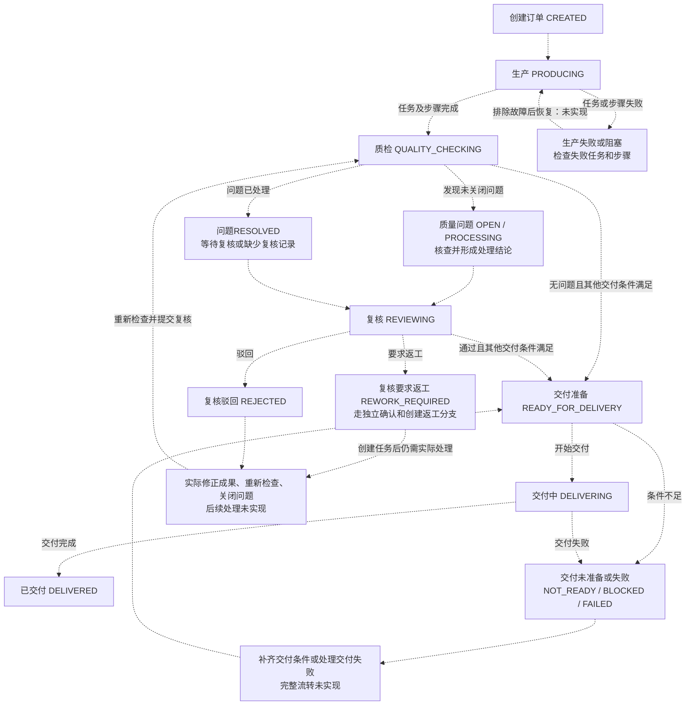

- 生产任务COMPLETED只代表生产完成；问题尚未解决时可复核并要求返工，不能直接APPROVED。
- 订单BLOCKED表示受阻，不是固定的独立阶段；需要结合任务、质检、复核和交付事实判断原因。
- 当前提交复核只新增复核记录并递增任务版本，不自动关闭问题或推进订单、交付状态。

## 2. 三端职责与数据归属

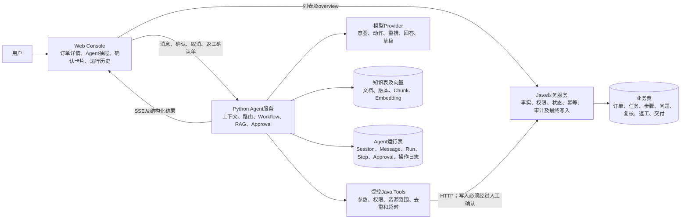

图中按表职责分组；当前本地环境可使用同一PostgreSQL实例，数据库角色尚未完整隔离。
Python运行时代码通过Java Tool取得业务事实，不直接查询Java业务表。

### 业务对象实际关联

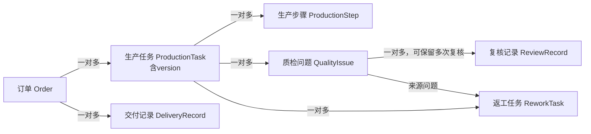

当前没有单独实现QualityTask或DeliveryBatch业务实体。

## 3. 页面与统一Agent入口

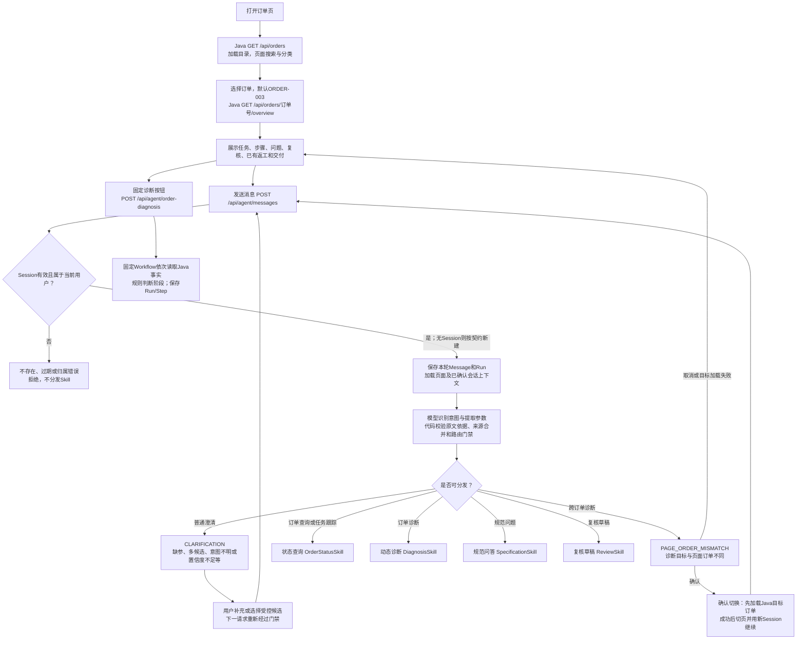

同一订单连续对话复用Session，每轮执行仍有独立Run。切换订单清理旧Session/SSE上下文，迟到响应不能覆盖新订单。

### 状态查询的两个分支

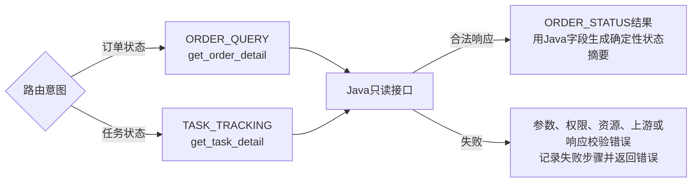

路由可能调用模型，状态值和摘要由Java事实及代码生成。

## 4. 动态诊断与阶段判断

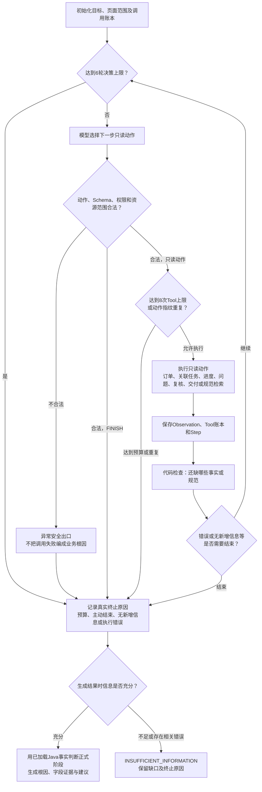

达到预算时若所需事实已收齐，仍可返回有依据诊断，同时保留MAX_ITERATIONS等真实原因；不能声称模型主动FINISH。
复杂多任务可能在预算内收不齐事实，不能补造事实或取消信息门禁。

### 正式阶段判断的优先级

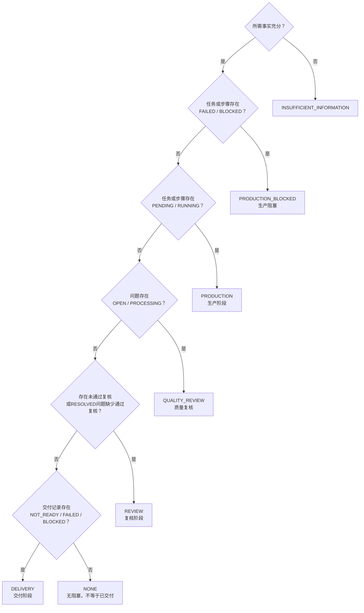

动态诊断按场景检查缺口，固定诊断要求完整事实集合。当前复核规则会检查已加载的非APPROVED记录，没有“只取最新记录”的自动覆盖机制。
ORDER-026正在交付、ORDER-027已交付，都可能得到NONE，需要结合交付记录区分。

## 5. 知识入库与规范问答

### 显式入库：不会因页面查询自动全量重建

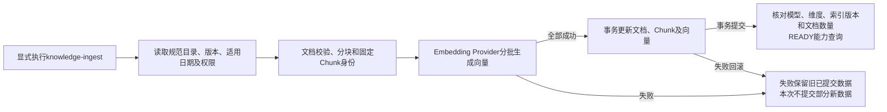

### 在线检索与回答

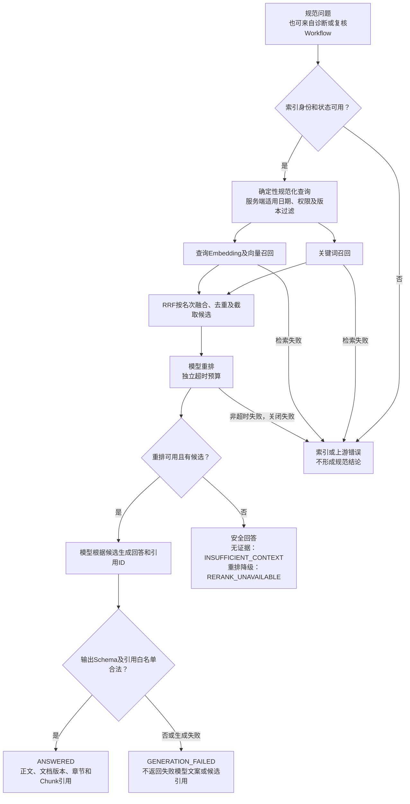

已校验引用是否来自本次候选集合；尚未实现逐句语义证据绑定、完整的“引用是否支持每句话”检查及自动历史引用迁移。
重排超时降级提供安全答复，不取消证据门禁。

## 6. 复核草稿与独立返工确认

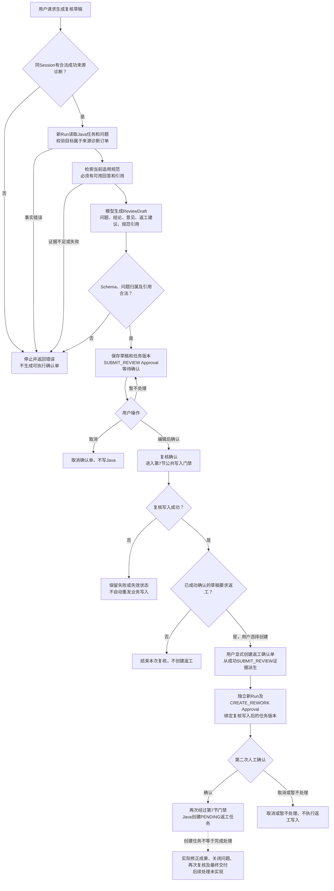

复核草稿生成时只读Java；创建第二张返工Approval也不等于已经创建Java返工任务，两次人工确认互不代替。
相同成功复核已有对应返工Approval时复用已有结果。当前Agent返工类型仅COORDINATE_SYSTEM_FIX，非坐标系场景本轮只读验证。

## 7. 公共写入门禁与失败分支

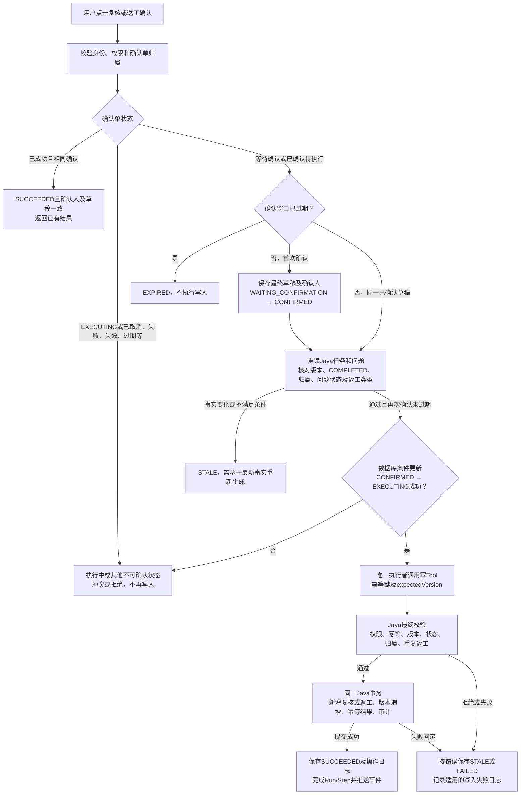

- EXECUTING由Python确认服务通过数据库条件更新设置；只有抢到执行权的请求才调用写Tool。
- Java用expectedVersion和幂等记录防重复；同一键不同请求内容会冲突。
- 复核要求任务COMPLETED、问题属于任务且未CLOSED；APPROVED只能用于RESOLVED问题。
- 返工要求问题未CLOSED；同任务、同问题已有PENDING/RUNNING/BLOCKED返工时拒绝重复创建。
- 到期检查发生在相关请求中，不表示存在后台定时扫描。确认前不重新运行RAG，规范适用性仍以草稿生成时检索为准。
- Python与Java没有跨服务原子事务。Java提交后若Python崩溃，幂等可防重复写；当前没有自动恢复任务。

## 8. 可观测性与异常处理

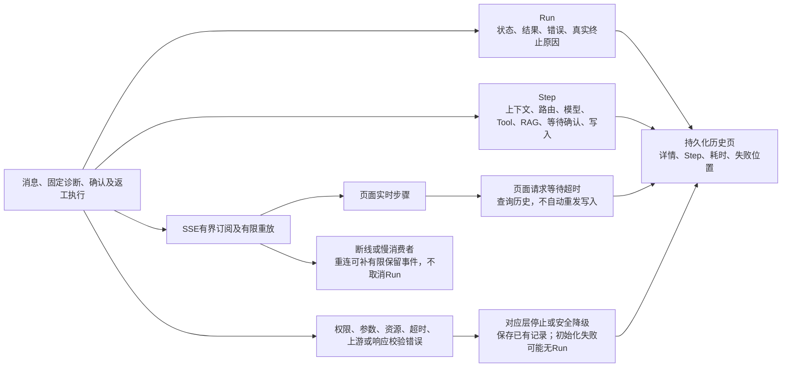

- SSE及Session运行上下文包含单进程TTL和有界内存能力，持久化Run历史不等于无限事件重放。
- 只读Java Tool只对明确瞬时错误有限重试；参数、权限、资源或响应不合法不能靠重试绕过。
- 写Tool实际开始后适用的成功或失败才产生对应操作日志；确认前取消、过期或STALE主要看Approval、Run与Step。
- 确认阶段顶部Tool计数存在遗漏，人工等待计入部分Run耗时；分析时结合WRITEBACK Step和Java审计。

## 9. 30单场景对应的验证分支

| 分支 | 代表订单 | 用途及边界 |
| --- | --- | --- |
| 无任务 | 006 | 事实不足 |
| 生产中 | 001、007、008、010 | 未开始、多步骤运行、部分任务未完成 |
| 生产阻塞 | 002、009、011 | 失败步骤与多任务阻塞 |
| 单坐标系问题 | 003、012 | 质检、复核与返工；003当前已有人工返工，012满足从头演示的基础数据条件 |
| 非坐标系问题 | 013～015、019 | 云量、几何、辐射等，只读验证 |
| 同任务多问题 | 016、017 | 其他问题已关闭不代表当前未关闭问题可放行 |
| 多任务预算 | 018、023、030 | 缺口未齐保留信息不足与真实终止原因 |
| 复核未通过或缺失 | 004、020～023 | PENDING、REJECTED、REWORK_REQUIRED、缺少记录 |
| 交付准备或失败 | 024、025、028 | 未准备、失败、多交付记录 |
| 无阻塞 | 005、026、027 | 区分可交付、交付中、已交付 |
| 已有返工 | 029、030；当前003 | PENDING、RUNNING、COMPLETED，不把创建任务当成实际修复完成 |

固定数据见[DEMO_DATA](DEMO_DATA.md)，历史真实演示见[AGENT_DEMO_FLOW](AGENT_DEMO_FLOW.md)。
本图未新增真实模型调用；场景覆盖和受控测试不代表真实模型准确率。

## 10. 核心代码索引

| 文件 | 职责 |
| --- | --- |
| [BusinessQueryService.java](../business-service/src/main/java/com/productline/business/application/BusinessQueryService.java) | Java目录与详情事实聚合 |
| [BusinessWriteService.java](../business-service/src/main/java/com/productline/business/application/BusinessWriteService.java) | 最终权限、版本、幂等、复核及返工写入 |
| [orderStore.ts](../web-console/src/stores/orderStore.ts) | 订单加载与迟到响应隔离 |
| [AgentWorkspaceDrawer.vue](../web-console/src/components/AgentWorkspaceDrawer.vue) | 消息、切页、SSE和人工确认 |
| [agent_messages.py](../agent-service/app/services/agent_messages.py) | Session/Run、上下文路由、澄清与分发 |
| [production_agent_skills.py](../agent-service/app/services/production_agent_skills.py) | 四个Skill的生产装配 |
| [order_status.py](../agent-service/app/workflows/order_status.py) | 订单查询与任务跟踪 |
| [dynamic_diagnosis.py](../agent-service/app/workflows/dynamic_diagnosis.py) / [diagnosis_rules.py](../agent-service/app/workflows/diagnosis_rules.py) | 动作循环、信息缺口与正式阶段 |
| [specification_qa.py](../agent-service/app/workflows/specification_qa.py) | 规范检索、重排、回答及引用门禁 |
| [knowledge_ingestion.py](../agent-service/app/services/knowledge_ingestion.py) | 知识入库与失败保留旧数据 |
| [review_draft.py](../agent-service/app/workflows/review_draft.py) | 来源诊断、最新事实、规范及草稿 |
| [approval_orchestration.py](../agent-service/app/services/approval_orchestration.py) | 取消及独立返工确认单 |
| [approval_confirmation.py](../agent-service/app/services/approval_confirmation.py) | 确认、过期/失效、执行权及写Tool |
