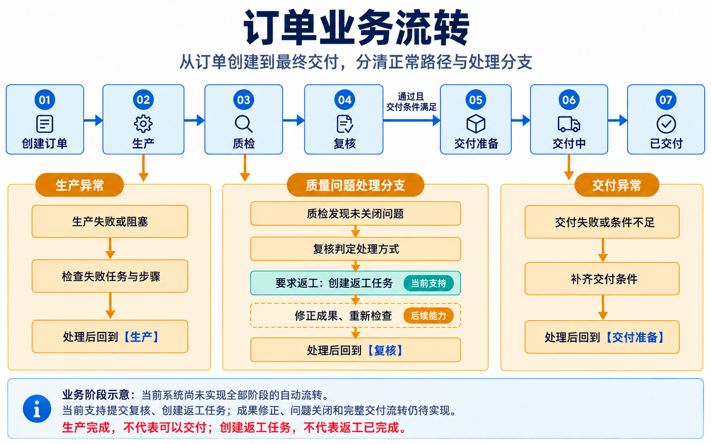
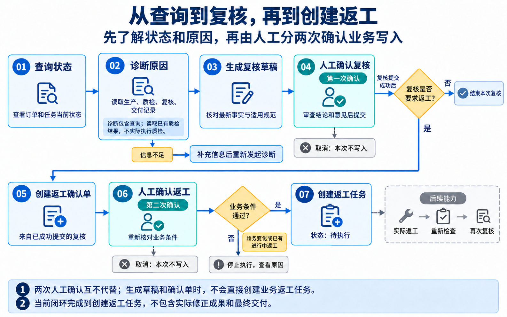
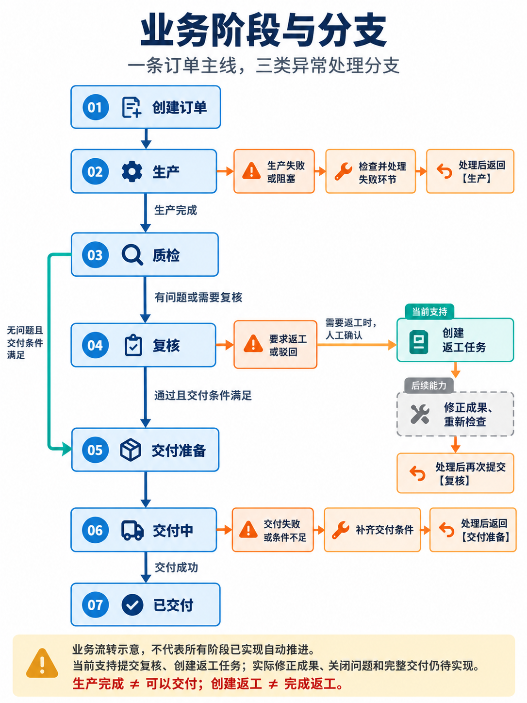
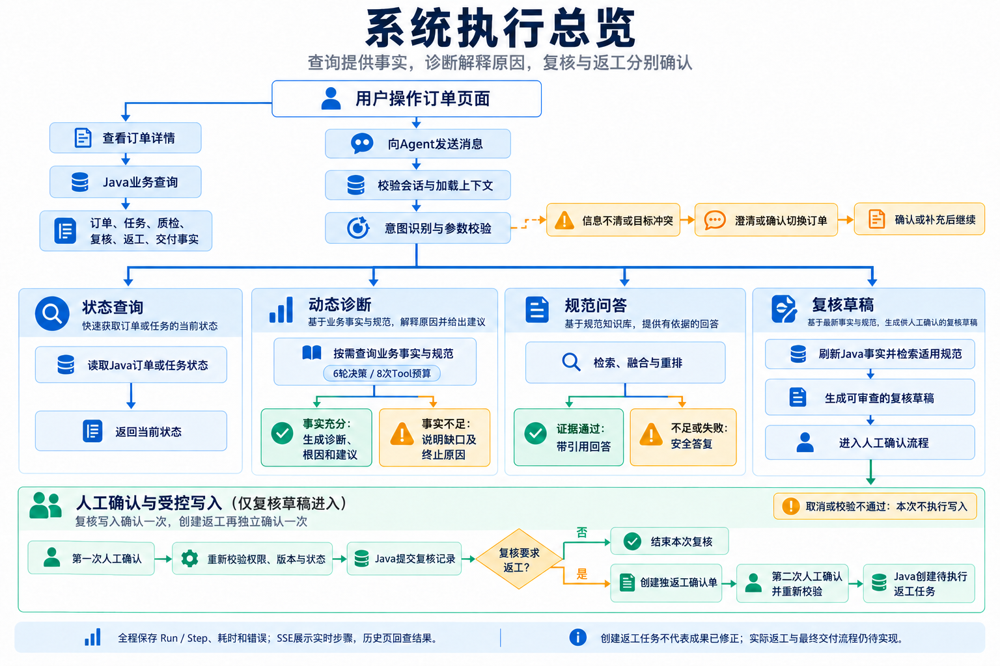

# 业务流程图

本目录展示业务流转、用户操作和系统执行总览，便于理解订单各阶段及查询、诊断、复核、返工的关系。
业务含义以2026-10-24的实现边界为准；详细说明见[系统全链路文档](../SYSTEM_FLOW.md)。

## 1. 订单业务流转

[查看原图](01-order-business-flow.png)

覆盖创建订单、生产、质检、复核、交付准备、交付中和已交付，以及生产阻塞、质量问题、
返工和交付异常分支。它表达业务上应有的阶段关系，当前没有覆盖全部阶段的自动流转。
图中主线为常见路径；没有质检问题且其他交付条件满足时，可直接进入交付准备，无需创建问题复核或返工任务。

## 2. 从查询、诊断到复核和创建返工

[查看原图](02-review-rework-flow.png)

覆盖状态查询、诊断取证、生成复核草稿、第一次人工确认复核、创建独立返工确认单、
第二次人工确认返工，以及信息不足、取消和业务条件变化时的处理。

## 3. 业务阶段与分支

[查看原图](03-business-stages-branches.png)

对应已确认的业务阶段图，展示七个阶段、生产异常、复核返工、交付异常，
并补充“无问题且满足交付条件时可直接进入交付准备”的路径。
分支末尾直接标明回到哪个业务阶段，便于阅读。

## 4. 系统执行总览

[查看原图](04-system-execution-overview.png)

对应已确认的系统执行总览，展示页面查询、统一消息入口、会话与上下文、意图及参数校验，
以及状态查询、动态诊断、规范问答、复核草稿四条路径。
复核与返工各自人工确认后才能写入，查询、诊断和规范问答不经过业务写入确认。

## 阅读这些图时注意

- 诊断包含查询，读取已有质检记录；当前不会执行影像检查或实际质检算法。
- 生产任务完成不等于质检、复核或交付完成。
- 两次人工确认互不代替；生成草稿或返工确认单不会直接创建业务返工任务。
- 当前支持提交复核和创建返工任务；成果修正、问题关闭和完整交付流转仍待实现。
- 坐标系以外的问题本轮仅验证只读查询，不新增对应返工类型。

图片中的简明表达不替代服务端校验和详细业务契约；后续流程变化时需同步更新图片及本说明。
