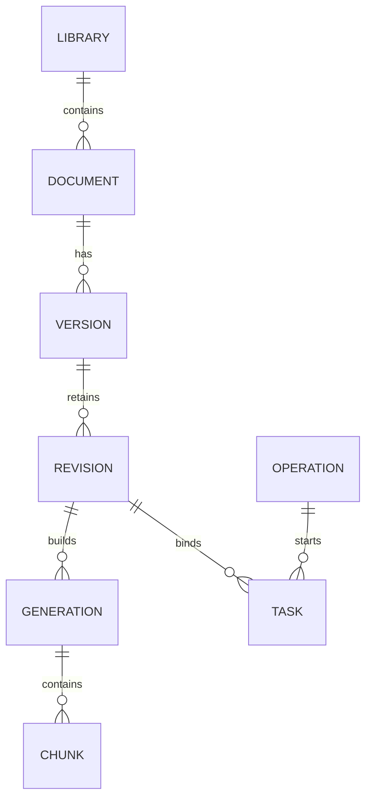

# KB-02.3 知识资料、版本、任务模型与存储隔离设计

## 解决的问题

现有全量入库会清理catalog之外的资料并替换旧分块，直接承载页面上传会影响新增资料及历史引用；现有知识表还不能分别表达草稿、确认、发布和处理失败。
本设计确定独立管理表、原件存储和版本状态边界，让后续开发可以逐项实现上传预览、候选索引、发布切换及历史回查。

## 核心作用

本设计承接KB-02.1 Java授权和KB-02.2 Python调用契约，为数据库迁移、文件接收及处理流程提供模型与约束。
资料按逻辑文档、规范版本、草稿修订及索引批次组织，操作记录绑定人工意图，任务记录保存处理结果，检索只读取当前发布指针。
Java继续裁决权限，Python依据自有知识数据执行确认、版本及状态事务；文件或外部模型调用不占用长期数据库事务。
KB-02.3阶段只形成设计文档；后续实现进度及边界见本文第九至十一节，不把整体设计视为全部已实现。

## 一、设计决定与当前事实

| 编号 | 决定 | 来源或默认值 |
|---|---|---|
| D01 | 新增独立管理与检索表，旧CLI继续使用原知识表 | 2026-10-29用户已确认 |
| D02 | 未发布草稿允许重新上传修正，每次增加修订号，旧预览和任务失效；发布后必须上传新的规范版本 | 2026-10-31用户已确认；不是在线编辑，旧任务历史记录保留，详见4.2 |
| D03 | 首版使用同一PostgreSQL实例中的Agent自有表，原件使用本地持久化目录及Docker命名卷 | 沿用现有部署；不增加对象存储、消息队列或复杂任务平台 |
| D04 | 管理库准备完成并验收后一次性切换问答源，不混查、不自动回退旧库 | D01的切换约束；知识库页与订单页使用同一服务端数据源 |
| D05 | 默认单个Agent实例负责管理任务，重启后任务明确中断且由人受控重试 | 首版部署限制，不声称已具备多实例任务调度 |

现有16份规范根据catalog中的明确替代关系归为14份逻辑资料，其中2份各有一个历史版本；不根据文件名推断关系。
旧数据仍在`knowledge_documents`和`knowledge_chunks`；旧Repository存在全局文件路径/正文哈希唯一约束、删除旧Chunk及裁剪目录外文档的行为。
旧就绪检查要求文档ID集合与固定catalog相同，不能直接用于动态管理库。现有Chunk ID由规范身份、章节、正文哈希和重复位置签名生成，不包含Embedding模型身份。

实现依据：[原模型](../../agent-service/app/models/knowledge.py)、[旧入库Repository](../../agent-service/app/repositories/knowledge.py)、[就绪检查](../../agent-service/app/services/knowledge_index_capabilities.py)、[分块身份](../../agent-service/app/knowledge/chunking.py)。

## 二、身份、不可变内容及关系

| 身份 | 含义 | 变化规则 |
|---|---|---|
| document_id | 同一份逻辑资料，串联其规范版本 | 创建后稳定，不用文件名或规范版本号充当主键 |
| version_id | 一版规范，例如同一资料的1.0与2.0 | 规范版本号在同一逻辑资料内唯一，字符串精确匹配，不作浮点比较 |
| revision_no | 未发布版本的第几次文件/元数据修订 | 从1递增；修正草稿创建新修订，原修订原件与处理历史保留 |
| generation_id | 对某个修订进行的一次索引构建 | 每次人工重试使用新批次，失败批次保留；批次内Chunk不得重复 |
| citation_document_id | 沿用现有引用格式的规范身份 | 初始纳管保留catalog document_id，新上传版本使用其稳定version_id |

新资料、版本、任务、索引批次和操作ID采用服务端生成的大写前缀加UUID大写十六进制字符，长度不超过128；UUID不用于随机化固定演示业务数据。
新索引可复用稳定Chunk算法，使用`citation_document_id`作为分块输入中的规范身份，初始纳管不重写已有Chunk ID。
同一规范版本发布后封存`published_revision_no`，重新生成向量不能改写这份正文。首版固定现有Embedding身份，模型/维度升级另行规划，不在启动时自动重建。

图中名称是下节表名的简称，展示整体目标；当前模型及上传解析实现见第九至十一节。

## 三、八张新表的职责与字段

统一使用Agent现有Alembic元数据，不创建Java业务实体或Flyway迁移。时间字段使用服务端UTC时区时间。
ID为`VARCHAR(128)`，哈希为64位SHA-256十六进制字符串，计数器为非负`BIGINT`，修订号为正整数。
下列字段是整体迁移目标；KB-02.4建立首批四表，KB-02.5补齐其余四表及版本封存关系，KB-02.6接入原件及上传解析应用。当前尚无对外管理接口或发布执行流程，实现边界见第九至十一节。

| 表名 | 职责 | 关键字段及约束 |
|---|---|---|
| managed_knowledge_libraries | 唯一内部知识库及读源切换 | `library_id=DEFAULT`单例，`source_mode=LEGACY/MANAGED`，`release_revision`，`source_catalog_hash`，创建/激活时间；不增加多知识库产品入口 |
| managed_knowledge_documents | 逻辑资料及当前发布指针 | `document_id`主键，`library_id`外键，`current_version_id`可空，`row_version`，创建人/时间；当前版本必须属于该资料 |
| managed_knowledge_versions | 规范版本及修订指针 | `version_id`主键，`document_id`外键，`specification_version`，唯一`citation_document_id`，`current_revision_no`，`published_revision_no`，`published_generation_id`，`publication_state`，来源与实际管理发布时间；唯一`(document_id, specification_version)` |
| managed_knowledge_revisions | 每次上传的不可变原件及元数据快照 | 联合主键`(version_id, revision_no)`，原件key/文件名/格式/字节数/raw_hash，正文快照及normalized_hash，metadata_hash、业务元数据、创建人/时间；原件key唯一，解析结果仅允许由空写入一次 |
| managed_knowledge_index_generations | 修订对应的索引批次 | `generation_id`主键，版本/修订外键，Provider、模型、1536维度、index_version、分块策略版本及输入哈希，`build_method=GENERATED/COPIED_LEGACY`、`state=BUILDING/READY/FAILED`和时间；批次输入不可变 |
| managed_knowledge_chunks | 某索引批次的检索正文与向量 | 联合主键`(generation_id, chunk_id)`，章节路径、顺序、正文、正文哈希、词元数、全文检索字段及VECTOR(1536)；唯一`(generation_id, chunk_index)`，新增本表独立GIN与HNSW索引 |
| managed_knowledge_tasks | 解析/索引任务的输入与结果 | `task_id`，`operation_id`，`task_type=PARSE/INDEX`，版本/修订/可空索引批次，状态、owner_id、attempt_no、retry_of_task_id、Trace及时间、受控错误码；同一操作的同类任务不重复，单一修订同类任务只能有一个排队或执行中实例 |
| managed_knowledge_operations | 人工动作、幂等、确认及审计 | `operation_id`，actor、Java动作、目标类型/ID、幂等键、input_hash、confirmation_snapshot、状态、结果身份/受控错误码及时间；唯一`(actor_id, action, idempotency_key)`，不保存Token或整篇正文 |

### 3.1 元数据与来源

每个修订保存标题、document_type、satellite_type、product_type、processing_level、specification_version、effective_date、expiry_date及permission_scope；使用显式类型字段参与SQL过滤，不能只藏在任意JSON中。
版本号与所属version行一致，日期满足失效日不早于生效日。元数据哈希覆盖这些业务字段，由服务端按规范化JSON计算，不能相信调用方自报哈希。
来源保存`CATALOG_IMPORT/UPLOAD`、可空原catalog document_id、catalog快照哈希及原生命周期/替代关系；导入按明确替代边分组，不能猜测文件名。

旧catalog的`ACTIVE/HISTORICAL`是来源信息，不直接承担新库发布状态。旧版被新版本替代时，不补造规范失效日，也不把停用伪装成规范失效。
旧作者/发布时间无法核实时保留未知；新管理库的导入时间、操作人和发布时间只记录实际发生的管理操作。

### 3.2 关系及唯一性

- `current_version_id`通过`(document_id, version_id)`组合外键绑定所属资料；版本的发布索引必须通过版本/修订/批次组合关系绑定本版本封存的修订。
- 在version表显式增加`UNIQUE(document_id, version_id)`，在generation表增加`UNIQUE(version_id, revision_no, generation_id)`，作为上述组合外键的合法引用目标。
- version的`current_revision_no`为必填正整数，`(version_id, current_revision_no)`指向修订的循环外键使用`DEFERRABLE INITIALLY DEFERRED`，允许同一事务先插版本再插修订，但提交时不得悬空。
- 通过部分唯一索引限制每份逻辑资料最多一个`PUBLISHED`版本；指针、发布状态和索引READY的跨行一致性由Repository事务保证，不能声称单个CHECK已覆盖跨表语义。
- 原件raw_hash、normalized_hash及metadata_hash不作跨版本全局唯一约束；允许只改元数据或版本号而正文相同。幂等和版本唯一约束负责重复请求保护。
- 复用单份资料的读取、规范化和分块能力，不把新库所有历史版本送入旧catalog的跨文档重复检测器，也不套用旧表的全局正文唯一约束。
- 同一Chunk ID在不同索引批次可出现，但必须代表同一规范身份、章节及正文；联合主键让历史索引共存，默认检索只选择发布批次。
- 创建表时先建立主体再补充循环指针外键；先插入空发布指针的资料，再插入版本、修订和批次，最后更新指针，不改已有迁移。

## 四、状态、草稿修正与确认事务

### 4.1 状态定义

| 对象 | 状态 | 规则 |
|---|---|---|
| 规范版本 | DRAFT、PUBLISHED、SUPERSEDED、DISABLED、HISTORICAL | DRAFT只供预览；PUBLISHED且为当前指针才可检索；SUPERSEDED表示曾发布后被替代；DISABLED表示主动停用；HISTORICAL仅承接初始历史来源 |
| 索引批次 | BUILDING、READY、FAILED | READY表示索引完整，不等于已被发布；未被发布指针引用的批次不进入问答 |
| 任务 | QUEUED、RUNNING、SUCCEEDED、FAILED、INTERRUPTED、STALE | STALE表示目标修订或确认条件已变化，INTERRUPTED表示进程重启；旧失败历史不覆盖 |
| 人工操作 | CONFIRMED、EXECUTING、SUCCEEDED、FAILED、STALE | 创建于明确用户操作，CONFIRMED不是模型推断；发布中不提前标记成功 |

发布前必须满足解析成功、索引READY、修订匹配、权限允许、确认匹配及元数据有效。首版拒绝将未来生效或已过期版本发布为当前依据；已发布后到期的资料由检索日期过滤排除，不自动修改原规范日期。
被替代或停用的版本不能重新变成DRAFT；首版不提供恢复旧版发布或永久删除。
最终模型中，DRAFT的发布修订/批次指针必须为空，PUBLISHED/SUPERSEDED/DISABLED必须具有封存修订及批次，且封存修订等于该版本最后修订；HISTORICAL仅允许CATALOG_IMPORT来源，历史封存批次不表示曾在新平台实际发布。
PARSE任务不绑定generation，INDEX任务必须绑定generation；READY批次必须经完整Chunk数量、身份与向量校验，跨行完整性由事务内读取和条件更新验证。

### 4.2 未发布草稿重新上传

草稿修正仍通过上传文件完成，不提供在线正文编辑。只有DRAFT允许修正，规范版本号保持；修改规范版本号需新建version。
新上传创建`revision_no+1`的原件及元数据快照，原修订不覆盖，并在短事务中按预期document.row_version和current_revision_no切换草稿指针。
旧修订的预览、确认输入和执行中的任务不再适用于发布；排队或执行中的旧任务标记STALE，已完成任务的历史结果保留并注明所属修订。
旧任务迟到结果必须再次核对任务状态、owner_id及当前修订，不能写入新修订、移动发布指针或将旧预览标为当前。
已发布版本的重新上传一律要求新的规范版本；不会因修正草稿而改写已发布规范。

### 4.3 人工操作与幂等

UPLOAD、PUBLISH、DISABLE、RETRY_INDEX沿用KB-02.1动作，不新增Java动作。上传提交本身是明确人工操作，发布/停用/重试分别确认，不能复用模型建议或业务Review Approval。
确认快照使用服务端事实，绑定actor、action、library/document/version、revision_no、正文及元数据哈希、预期资料row_version、原发布指针和需要时的目标task/generation；不存凭据或无关上下文。
同一actor/action/幂等键和相同input_hash重放返回原操作/任务，载荷不同则冲突；新幂等键也不能突破版本唯一及同修订任务并发限制。
唯一约束处理首次并发，条件更新处理执行权；创建/推进操作、任务和指针的事务失败全部回滚。
UPLOAD操作成功表示原件、修订和解析任务已持久化，不等于解析成功；解析结果单独看task。PUBLISH须在实际切换发布指针后才成功，DISABLE须在指针清空后才成功。

### 4.4 发布与停用时序

1. 读取当前候选与资料事实生成预览；用户确认后调用Java校验对应动作，外部HTTP不放在数据库长事务中。
2. 在短事务中重新核对候选、修订、哈希和预期row_version，保存确认快照及幂等记录，预留新的执行row_version；没有匹配的READY索引时创建索引任务，已有完全匹配批次时复用并跳过向量构建。当前已发布指针保持可用。
3. 事务外构建向量，结果只绑定该任务、修订和索引身份。全部批次校验成功后才准备保存完整Chunk集合，不把半批数据标为READY。
4. 构建结束后在事务外再次调用Java检查PUBLISH权限，再在短事务校验任务执行权、修订、预留row_version及确认快照，一次写入完整Chunk并将批次标READY、INDEX任务标SUCCEEDED；PUBLISH操作保持EXECUTING，候选尚未进入检索。这是KB-03.3实现的候选保存边界。
5. KB-03.4在最终发布前再次检查Java PUBLISH权限，在最终短事务复核操作、确认快照、当前知识事实及READY索引完整性；先把旧版本标SUPERSEDED，再发布新版本、切换指针、递增library.release_revision并完成操作。管理库发布不等于统一问答读源已切换，当前仍为LEGACY。
6. 任一条件变化或构建失败，旧发布版本不变。不能把Java早先授权、Embedding成功或候选READY当成最终执行成功。

KB-03.5停用不调用Embedding：Java DISABLE授权后在同一短事务核对目标为当前发布版本、确认摘要及row_version，设置DISABLED、清空当前版本指针、递增资料/库发布修订并保存操作结果；同资料上基于旧事实的未完成发布/索引意图失效。
停用后不自动恢复更旧版本，旧原件及Chunk继续用于已存在引用的回查。
执行中的身份上下文只在当前任务内存持有，数据库不保存Token；权限拒绝、凭据过期或Java不可用均停止最终发布，重启后必须由用户携带新的有效身份重新发起操作。

## 五、原件持久化与失败处理

KB-02.6已增加`KNOWLEDGE_STORAGE_ROOT`配置，本机默认解析为仓库根的`.local/knowledge-storage/`，Compose显式设为`/var/lib/productline-agent/knowledge`并挂载`knowledge-data`命名卷。
显式配置须为不含父级跳转的绝对路径；POSIX存储适配器拒绝目录链中的符号链接。默认目录已加入.gitignore，构造服务不创建目录，只有实际上传才惰性创建；本批没有重建容器或修改现有运行卷。

原件key固定为`versions/<version_id>/revisions/<revision_no>/original.md`或`original.txt`；客户端文件名只作展示，不参加目录拼接。
默认单文件最多10MiB，按流累计字节限制；只接受MD及UTF-8 TXT，解析校验编码与空内容，不展开压缩文件。
保留原字节及raw_hash；规范化正文另存数据库，normalized_hash使用现有BOM/换行规则，不能拿原字节哈希替代规范化内容哈希。

先写受控临时文件，完成长度/格式/编码/哈希检查，再原子创建最终原件入口并提交数据库引用。KB-02.6采用同文件系统硬链接创建及临时入口清理，避免普通改名覆盖已存在原件；最终入口创建后再次校验字节并同步目录。读取时按ID查库定位key，拒绝绝对路径、`..`及符号链接，物理路径不对外返回。
文件系统与数据库不构成同一事务：文件提交成功而DB失败时可能留下未引用文件。首版保留在受控目录，不自动删除、不纳入检索，排查通过脱敏操作身份进行；后续清理必须另设明确范围和审批。
读取原件缺失或校验失败时返回明确错误，不拿另一版或仓库文件冒充。DB中的既有引用原文不因原件下载失败而改写，备份恢复需同时覆盖数据库与原件卷。

## 六、任务中断与重试

首版单个管理任务实例使用进程唯一owner_id，以QUEUED→RUNNING条件更新领取任务；同修订同类任务的部分唯一约束防止并发重复启动。
管理服务激活时将旧owner的QUEUED/RUNNING任务记为INTERRUPTED，并记录受控原因；不自动执行外部模型或继续未完成的索引构建。KB-02.6的`start`可显式调用，也会在首个已授权管理调用时惰性运行；普通FastAPI启动只装配对象，不要求现有运行库已迁移。
对应尚未结束的发布/索引重试操作记为FAILED，保留中断原因；已成功接收文件的UPLOAD操作不改写为失败，其解析任务单独显示中断。
KB-03.6已实现INDEX任务的人工重试：重新校验Java RETRY_INDEX权限、明确确认及目标修订，创建新操作、新task和新generation，通过retry_of_task_id保留直接失败父节点，不把原失败记录改成成功或从旧节点分叉。
RETRY_INDEX只构建READY候选，不自动发布；成功后需要新的PUBLISH确认和Java权限检查才能切换指针，不复用原失败发布的授权。新发布可以复用该READY批次，不重复生成向量。
PARSE失败或中断通过UPLOAD重新上传修正草稿、生成新修订和解析任务，不借用RETRY_INDEX权限，也不新增未约定的Java动作。
旧修订或已不适用目标不能重试；新任务输入始终来自保留的不可变修订，不信任客户端提交的正文、状态或路径。
错误记录仅含内部白名单错误码、阶段、Trace及时间，不保存凭据、绝对路径、正文或供应商原始异常。
多实例租约、自动故障接管及跨实例队列不在本版，不能将单实例重启处理描述为已具备分布式恢复能力。

## 七、初始纳管、统一切源与就绪检查

### 7.1 初始16版本纳管

未来通过显式运维入口执行，要求明确人工确认并调用Java检查UPLOAD/PUBLISH权限，应用启动不纳管、不调用Embedding。
按catalog的替代关系建立14个逻辑document和16个version，各建立revision 1；14个当前版本准备为PUBLISHED，2个历史版本为HISTORICAL，保留原日期、类型、权限、替代关系和引用规范ID。
复制原件及既有80个Chunk/向量前，校验源文件、规范化正文、章节、Chunk身份、catalog快照和完整Embedding身份一致；`build_method=COPIED_LEGACY`记录复制来源，不能冒充重新调用了模型。
任一数据缺失或不匹配时停止，不隐式付费补齐、不删除旧数据。纳管过程可在源快照不变时重放，不重复建立资料、版本或批次；来源不同则冲突，不覆盖已纳管历史。
导入实际时间、操作人、任务和新的管理发布时间记录实际值；旧规范原发布人/时间未知时仍为空，不伪造旧平台发布记录。

### 7.2 数据源统一切换

新singleton起始为LEGACY，现有CLI、固定测试及问答继续用原表。管理库准备完成前，草稿可预览，但公共发布/停用不作为线上已生效操作；初始纳管是受确认的内部准备流程。
全部纳管数据及索引验收后，由独立人工操作再次校验Java PUBLISH权限及源快照，在短事务将source_mode改为MANAGED并递增release_revision。
知识库问答与订单规范检索从同一服务端选择器取得模式；MANAGED只使用新表，LEGACY只使用旧表，不合并候选或在故障时静默切回旧表。
首版不提供MANAGED→LEGACY的反向切换，避免停用资料或新发布规则被旧库重新放行。旧CLI仍可维护旧表，但不能更新、裁剪新表或影响MANAGED发布集合。

### 7.3 检索、就绪和历史引用

新Repository按document当前版本指针、version封存修订和发布generation关联Chunk，先应用权限、产品、卫星、处理级别、版本及日期条件，再执行TopK。
查询Embedding生成在读取检索数据的短事务前完成；一次检索的source_mode、release_revision、发布指针与关键词/向量候选在同一REPEATABLE READ快照内读取，生成答案不持有该事务。
引用继续保留规范ID、规范版本、章节、Chunk ID及原文，历史版本和索引不被新构建覆盖。后续Run策略快照补充数据源模式、发布修订与实际索引身份，不能重写旧Run中未记录的字段。

新就绪检查依据实际发布集合及完整索引身份，不再比较固定16个catalog ID；草稿、历史、失败批次不占用发布集合的完整性统计。
所有资料停用时发布计数为0，`ready=false/NOT_INDEXED`并明确“无已发布资料”，不回退旧库。新计数契约必须允许0，并同步Python/前端Schema及测试，不能直接套用旧`expected_document_count>0`约束。
就绪代表索引可用，不保证当前问题有适用证据；过期资料仍由检索日期条件排除。现有关键词零召回和最终回答质量问题不会因表结构改变而自动解决。

## 八、后续开发切分与验收

| 任务 | 最小交付 | 停止线 |
|---|---|---|
| KB-02.4 | 新资料、版本、修订Schema/ORM和增量迁移，先建立library/document/version/revision四表及约束 | 迁移、引用关系、状态输入和并发约束可在隔离数据库验证；不接上传或线上迁移 |
| KB-02.5 | 操作/任务/索引批次/Chunk四表及约束，补齐循环引用与任务关系 | 管理模型完整，失败/重复/并发关系验证通过；不实现后台模型调用 |
| KB-02.6 | 原件存储适配及上传/解析应用服务 | 路径、大小、编码、修订替换和DB失败孤儿文件有明确行为；草稿不进问答 |
| KB-02.7 | 只读管理接口：资料列表、详情、版本及任务查询，接入READ授权 | 身份/范围过滤和脱敏结果可验证，不同时建设上传接口或页面 |
| KB-02.8 | 上传与草稿修订HTTP接口，复用KB-02.6应用 | 文件提交、幂等和失败响应可验证，不同时建设发布或页面 |
| KB-02.9 | 正文与分块预览HTTP，复用KB-02.6应用 | READ授权、当前/历史修订和失败响应可验证，不同时建设发布或页面 |
| KB-02.10 | 原件读取HTTP接口 | 授权、资料归属、下载响应及完整性错误可验证；随后收口KB-02验收，不自动扩建发布或页面 |
| KB-03 | 索引执行、确认发布、停用、初始纳管及统一切源 | 原有KB-03停止线不变，按可测试小任务分别验收 |

循环外键分两次迁移建立：KB-02.4先建立资料→版本→修订及当前版本归属约束，仅开放DRAFT数据持久化；依赖generation的发布指针字段及状态约束到KB-02.5随新表、归属外键和索引一起加入，不先接受悬空批次ID。
迁移必须基于实施时真实Alembic head新增，不预先承诺固定迁移编号；不修改0014及此前迁移，也不把设计文档当作已执行迁移。

验收用例包括：同版本草稿修订替换与旧任务迟到、已发布版本不可改、同正文不同版本合法、幂等重放/冲突、两个发布并发、构建失败保留旧版、停用不回退、原件丢失/越界、重启不自动付费、旧CLI只影响旧表、初始14资料/16版本关系与原引用保留、切源后无混查、零发布资料的就绪状态，以及ORDER-003黄金链路回归。

KB-02.3验收只核对文档、关系、固定资料映射及当时的相关局部回归，不新增已实现的Agent面试关注点或功能里程碑记录；后续实现按下节范围及STATUS.md记录。

## 九、KB-02.4 首批Schema、ORM与迁移

### 解决的问题

只有设计文档时，资料、版本及修订仍无法持久化，也无法验证同一规范版本重复写入、修订指针悬空或跨资料引用等错误。
本任务建立独立基础表及严格内部快照，先让这些关系和失败回滚在数据库中可验证，为后续管理应用提供数据底座。

### 核心作用

本阶段承接Java授权与Python授权Client，定义内部知识库、资料、规范版本和修订的输入边界，由数据库保存关系、原件定位信息和元数据快照。
Schema拒绝非法状态、格式、日期、来源及不匹配的正文哈希；组合外键、唯一约束和延迟外键约束分别保护归属、重复版本和同事务创建版本/修订。
当前没有对外管理接口或Repository操作，授权仍须由后续应用在执行前调用Java，模型和页面不能借这些内部记录获得权限。

### 已实现范围

- [内部Schema](../../agent-service/app/schemas/managed_knowledge.py)：`ManagedKnowledgeLibraryState`、`ManagedKnowledgeDocumentState`、`ManagedKnowledgeDraftVersion`、`ManagedKnowledgeMetadata`及`ManagedKnowledgeRevisionSnapshot`。内部快照拒绝额外字段；元数据哈希由`metadata_digest`按固定JSON计算，覆盖业务字段、演示标识、维护主体和变更说明，不接受自报`metadata_hash`。
- [四表ORM](../../agent-service/app/models/managed_knowledge.py)：library/document/version/revision。规范版本号在同一资料内唯一，引用身份及原件key唯一；原件和正文哈希没有跨版本唯一限制。修订中的规范版本号通过组合外键与版本行一致。
- [0015增量迁移](../../agent-service/migrations/versions/0015_managed_knowledge_drafts.py)：基于`0014_review_source_run`新增四表、循环外键和`DEFAULT`库记录。该记录固定`LEGACY`且未激活；版本仅允许`DRAFT`，不导入固定语料、不修改旧表、不切换问答源。降级仅移除本迁移新增对象。
- 版本指向当前修订的外键为`DEFERRABLE INITIALLY DEFERRED`：允许同一事务先插版本再插修订，提交时没有对应修订则整笔回滚。`current_version_id`只校验资料归属，发布指针与状态的跨行一致性仍由后续发布事务负责。
- 正文快照保留规范化后的首尾空白；正文与规范化哈希必须成对，并核对实际SHA-256。原件字节哈希需要后续文件接收器计算，本阶段不接收或读取实际上传文件。

### 验收入口及后续边界

`make test-knowledge-models`包含新旧Schema测试及隔离PostgreSQL测试。新增持久化测试在独立数据库中以旧表哨兵验证`0014→0015→0014→0015`，并核对四表与ORM一致、外键、唯一约束、回滚和真实锁竞争；同一入口既有持久化测试继续验证完整旧迁移链及旧检索行为。
也可向专用测试PostgreSQL配置`AGENT_PERSISTENCE_TEST_DATABASE_URL`，在agent-service执行`.venv/bin/pytest -q tests/knowledge/test_managed_knowledge_persistence.py`；测试只迁移自行创建的临时库，连接用户须能创建/清理测试库。

快照冻结仅约束Schema对象；数据库字段不等于已具备业务不可变保护。修订号连续递增、原件落盘、解析结果只写一次、旧任务失效、操作幂等和封存均待应用服务实现。
KB-02.4验收时未增加Java/前端接口、文件目录/卷、后台任务或模型调用，发布修订及索引批次字段当时不存在；后续KB-02.5范围见第十节。KB-02.4不新增Agent面试关注点。

## 十、KB-02.5 操作、任务、候选索引与封存关系

### 解决的问题

首批四表不能保存人工操作、处理失败和重试关系，也无法区分已构建的候选索引与已封存的规范证据。
本任务补齐处理模型及数据库关系，让后续服务有地方保存幂等身份、确认快照、任务进度和历史分块，避免重复任务及跨版本引用。

### 核心作用

本阶段在资料、版本和修订之后接入操作、任务、索引批次及分块，输入为严格内部记录，输出为可验证的持久化关系。
确认记录绑定用户、动作、目标修订及哈希，任务关联操作、修订和重试来源；候选批次保留索引身份，分块按批次共存，规范版本通过组合外键引用本修订的封存批次。
数据库只保护已定义的结构和并发约束；Java授权、人工意图核验、文件及模型处理、重启恢复和最终发布事务仍须由后续应用实现。

### 已实现范围

- [处理Schema](../../agent-service/app/schemas/managed_knowledge_processing.py)：`ManagedKnowledgeConfirmation`、`ManagedKnowledgeOperationRecord`、`ManagedKnowledgeTaskRecord`、`ManagedKnowledgeGenerationRecord`和`ManagedKnowledgeChunkRecord`，拒绝额外字段及凭据/正文载荷；校验操作与快照身份、状态/时间/错误组合、重试输入、正文哈希及有限非零1536维向量。
- [处理ORM](../../agent-service/app/models/managed_knowledge_processing.py)：操作、任务、索引批次及Chunk四表，与首批四表共同构成八表管理模型。没有任务调度器、Repository或外部调用。
- 操作统一以规范版本为目标，保存`target_type=VERSION`及`target_id=version_id`；RETRY_INDEX的原任务在严格确认快照和新任务的`retry_of_task_id`中保存。KB-02.5只提供幂等键唯一约束；KB-02.6已接入UPLOAD同载荷重放和不同载荷冲突，其他动作仍待后续服务。
- 确认快照采用JSONB，Schema限制固定字段；数据库检查身份绑定、关键字段及键白名单，拒绝JSON空值身份或附加Token字段。该记录不等于已验证Java权限或已核实知识事实，执行前仍须重读自有数据并复查权限。
- 任务通过组合外键绑定同一版本/修订的操作及批次，原重试任务必须属于同一修订、同一类型；同一操作同类任务唯一，同一批次只关联一个索引任务。部分唯一索引限制同修订同类任务最多一个QUEUED/RUNNING实例；失败、中断和失效历史可保留。
- 原件解析任务仅允许UPLOAD且不绑定generation；索引任务仅允许PUBLISH/RETRY_INDEX并绑定generation。RETRY_INDEX必须指向原任务并使用新的attempt_no，原任务是否可重试及次数连续性仍由后续应用复核。
- 候选批次保存Provider、模型、1536维度、索引/分块版本、输入哈希及构建来源；READY要求正分块计数和完成时间，FAILED保存受控原因。实际数量、分块身份及向量完整性属于跨行校验，尚未实现。
- Chunk使用`(generation_id, chunk_id)`联合主键及批次内顺序唯一约束；不同批次可保留相同稳定Chunk身份，新增独立GIN和HNSW索引。内部快照保留元组不可变性，写入pgvector时转换为列表；现有测试使用`model_dump(mode="json")`，后续Repository须做同等转换。
- [版本状态Schema](../../agent-service/app/schemas/managed_knowledge.py)新增`ManagedKnowledgeVersionState`，保留上传入口专用的`ManagedKnowledgeDraftVersion`；后者仍拒绝自报发布状态。版本增加封存修订、批次和实际管理发布时间，HISTORICAL仅允许历史catalog来源且不伪造发布时间。
- [0016增量迁移](../../agent-service/migrations/versions/0016_managed_knowledge_state.py)基于0015，扩展发布状态及行内封存约束，增加同资料最多一个PUBLISHED版本的部分唯一索引，并通过版本/修订/批次组合外键防止引用其他版本的批次。0015及此前迁移保持原样。

### 验收与后续边界

`make test-knowledge-models`覆盖新旧Schema、八表与ORM一致性、非法输入、并发幂等键/活动任务排他、失败重试、历史分块共存及发布引用失败时原指针保留。
增量迁移可在隔离库升级/降级；0016降级前要求所有版本仍为DRAFT，有封存版本时整个降级事务失败，保留证据，不自动转换或抹去发布历史。

本批仍固定LEGACY读源，不执行资料纳管或问答切源。数据库外键不能证明候选READY、发布指针与状态一致、权限有效或确认仍适用；也没有禁止所有直接SQL修改的封存触发器，不能据此宣称发布闭环已完成。
KB-02.5验收时以上处理流程尚未接入；KB-02.6交付见第十一节，发布与停用执行仍待后续任务。KB-02.5不新增Agent面试关注点。

## 十一、KB-02.6 原件、上传修订与解析应用

### 解决的问题

只有八表模型时，真实文件仍无法安全保存，重复上传、草稿修正和迟到解析也缺少事务边界。
本任务把Java授权、独立原件和确定性解析接成内部应用服务，让接收结果、失败记录、旧修订及原文回查能够验证。

### 核心作用

上传输入为明确文件提交、业务元数据和可选目标快照；Java裁决UPLOAD权限，Python在短事务中复查资料、规范版本及修订，交付草稿/操作/任务身份。
文件写入及解析放在事务外，解析结果提交前再次检查owner、任务状态、当前修订和正文是否已写入；预览和原件读取分别验证READ权限。
该服务没有对外路由或Agent Tool注册，不生成向量、不切换LEGACY问答源、不发布规范，也不能让文档授予业务操作权限。

### 输入和处理约定

| 操作 | 命令目标 | 约束 |
|---|---|---|
| 新资料 | 无document/version及预期计数 | 服务端生成资料/版本身份及revision 1 |
| 已有资料新增规范版本 | document_id和expected_row_version | 同资料规范版本号唯一，原发布指针不变 |
| 修正未发布草稿 | document_id、version_id及预期资料计数/修订号 | 仅DRAFT且规范版本号保持，接收成功才创建revision_no+1 |

- [上传Schema](../../agent-service/app/schemas/knowledge_management.py)拒绝调用方提交原件key、正文哈希或发布状态；文件名只作展示，拒绝目录分隔符及控制字符。演示标识、维护主体及权限范围沿用已确认元数据契约，操作人使用本次Java授权的实际用户。
- [原件适配器](../../agent-service/app/knowledge/storage.py)逐级使用目录描述符与NOFOLLOW，流式累计10MiB上限，校验UTF-8、非空和数据库不能保存的NUL字符。非法格式、大小、编码或空文件在接收前拒绝并清理临时文件，不改变原草稿或产生新修订。
- [上传服务](../../agent-service/app/services/knowledge_management.py)每次重新检查Java权限，幂等重放也不能复用旧授权。输入哈希覆盖文件原字节身份、文件名、元数据及目标快照；相同用户/UPLOAD/幂等键同输入返回原操作及任务，不同输入明确冲突。
- [事务Repository](../../agent-service/app/repositories/managed_knowledge.py)用幂等键事务锁及唯一约束保护重复提交，锁定资料后复查row_version、当前修订、DRAFT状态及规范版本号。接收事务保存修订、UPLOAD成功记录与PARSE任务，递增资料计数；旧排队/运行任务及待执行发布意图失效，旧完成结果不覆盖。
- [单份解析](../../agent-service/app/knowledge/managed_parsing.py)复用已有BOM/换行规范化、Markdown标题校验和稳定分块。分块输入只要求引用身份与标题，不补造旧catalog的ACTIVE或有效期，不调用跨文档重复检测器；同正文不同版本合法。
- 成功接收后，在独立事务领取当前owner的PARSE任务，事务外解析，最后原子写入正文/normalized_hash及任务成功状态；正文只由空写入一次。Markdown必须以与元数据匹配的一级标题开始，失败保留草稿、原件和PARSE_FAILED记录，UPLOAD仍表示接收成功。
- 修订变更、任务失效、owner变化或管理服务中断后，迟到结果不能覆盖当前正文。明确启动或首次授权管理调用将旧owner未完成任务标INTERRUPTED，未完成发布/索引重试操作及构建批次标失败；不重写成功UPLOAD，不自动执行旧任务或调用模型。
- 服务提供带修订及资料计数的正文/分块预览和授权原件读取。旧预览可历史回查并标记非当前修订，不等于有效发布确认；分块仅在内存中预览，不写向量或检索表。原件缺失/摘要不符明确失败，既有数据库原文不被其他文件替代。

### 文件与数据库失败边界

文件与PostgreSQL不共事务。原件入口创建而数据库提交失败时保留未引用文件，返回KNOWLEDGE_PERSISTENCE_UNAVAILABLE，不自动删除或纳入检索。
同一版本/修订路径再次上传相同字节可以校验复用；不同字节返回ORIGINAL_CONFLICT。此时可先以原文件重试完成接收，再上传下一修订，或新建规范版本，不能默默覆盖孤立原件。清理仍须另行明确范围。
数据库失败与解析失败分别处理；取消不会伪装成成功，已领取任务保留执行中事实供管理服务重新激活时标中断。

| 结果或错误码 | 含义 |
|---|---|
| UNSUPPORTED_FORMAT / FILE_TOO_LARGE / INVALID_ENCODING / EMPTY_DOCUMENT / INVALID_TEXT_CONTENT | 接收前拒绝，原草稿保持 |
| IDEMPOTENCY_CONFLICT | 同一幂等键携带不同输入 |
| STALE_DOCUMENT / STALE_REVISION / SPECIFICATION_VERSION_CONFLICT | 资料快照、当前修订或规范版本不匹配 |
| SEALED_VERSION_REQUIRES_NEW_VERSION | 已发布或其他封存版本不能重新作为草稿修改 |
| PARSE_FAILED / STORAGE_ERROR | 任务解析或原件访问失败，不等于上传记录应被删除 |
| PREVIEW_NOT_READY | 尚无可信解析正文，不能伪装空预览成功 |
| ORIGINAL_NOT_FOUND / ORIGINAL_INTEGRITY_ERROR / ORIGINAL_CONFLICT | 原件缺失、校验失败或禁止覆盖 |

### 装配、验证与后续边界

FastAPI lifespan仅装配`knowledge_management_service`，不主动查询Java、读取原件、创建目录或启动工作任务；现有健康检查无须先迁移新表。管理服务激活前必须已显式执行已有0015/0016迁移，本批没有新增迁移或部署。
`make test-knowledge-management`验证离线文件及解析边界，再用隔离PostgreSQL和真实授权Client/模拟Java响应验收应用；真实Java联调、HTTP管理路由及真实进程/容器重启仍待后续阶段。
共享数据库夹具只迁移自动创建的测试库；mypy配置显式命名空间，使测试辅助模块与Python导入路径一致，不改变运行模块加载。
下一最小任务为KB-02.7只读管理接口。当前仍是单管理实例、无分布式租约、无后台模型/索引任务执行、无发布或停用接口，也没有旧版本恢复发布及永久删除。

## 十二、KB-02.7 资料、版本和任务只读管理接口

### 解决的问题

内部上传应用已保存资料、草稿修订和任务，管理端仍无法通过HTTP查看处理结果，也不能直接把数据库记录作为页面响应。
本任务补充经过Java授权、范围过滤和字段白名单处理的只读接口，让后续页面能够安全查询资料及失败记录。

### 核心作用

接口接收演示身份、资源ID及分页条件，每次调用Java READ授权，再由独立只读Repository查询Python自有管理表并返回元数据和任务事实。
权限范围只来自授权响应，不接受页面自报范围；不存在、范围不匹配及版本归属错误统一返回404。
GET不激活上传服务、不恢复或领取任务、不读取原件、不生成向量，也不切换现有规范问答的数据源。

### 已实现接口及输入输出

以下路径均以`/api/agent/knowledge`为前缀：

| 方法 | 路径 | 输出 |
|---|---|---|
| GET | `/documents` | 资料摘要分页，每份资料附最新可访问规范版本 |
| GET | `/documents/{document_id}` | 单份资料摘要、row_version及最新可访问规范版本 |
| GET | `/documents/{document_id}/versions` | 规范版本元数据分页，包括草稿、停用及历史状态 |
| GET | `/documents/{document_id}/versions/{version_id}` | 指定资料下的版本元数据，校验归属 |
| GET | `/documents/{document_id}/tasks` | 资料所属处理任务分页，保留旧修订的完成及失败记录 |
| GET | `/tasks/{task_id}` | 指定任务的状态、修订、耗时所需时间点及受控错误 |

- 身份沿用`X-User-Id`、`X-User-Role`及可选Bearer Header，Java校验REVIEWER演示角色；没有新增生产认证或复杂权限平台。
- ID沿用管理库的大写前缀与32位十六进制格式。分页默认`page=1/page_size=20`，页码上限1000000，每页1～100项；越界或非法格式返回422。
- 资料及版本按版本创建时间倒序、版本ID倒序稳定排列；资料选取最新可见版本，不按规范版本字符串排序，也不将它称为当前发布版本。
- 范围过滤先于去重、总数统计和分页；空库返回`items=[]/total=0`，越过末页保留真实总数。子列表的父资料不可见时返回404，不伪装为空集合。
- 资料/版本查询依据当前修订的权限；任务依据其所属修订的权限，并返回`is_current_revision`。任务按创建时间及任务ID倒序；计数与条目在同一REPEATABLE READ事务快照中读取，不加行锁。
- 版本只返回明确业务元数据、显示文件名、大小、格式、解析是否完成和发布状态；不返回正文、原件key、哈希、内部索引批次、操作者身份或确认快照。历史正文与原件仍由后续HTTP任务接入。
- 任务错误码采用受控映射和固定文案；未知历史错误统一为`PROCESSING_FAILED`，不复制异常原文。`retry_available=false`表示本批没有可执行重试接口，不能当作状态已满足重试条件。

### 错误、验证与后续边界

错误结构统一为`trace_id/code/message`：缺失或非法身份401、Java拒绝403、不可见资源404、授权超时504、其他授权不可用或非法响应502、知识查询/数据校验失败503。
每次GET重新授权，权限撤销后不复用上次成功结果；授权调用结束前不打开SQL会话，授权失败不回退旧库。查询不依赖Embedding或回答模型配置。

`make test-knowledge-management`包含HTTP身份/参数/失败测试，以及真实隔离PostgreSQL中的上传后查询、分页、未来草稿/停用版本、过期修订任务、权限范围、跨资料版本、任务不变性和LEGACY保护验证。
测试使用真实授权Client及模拟Java响应；真实Java HTTP联调、部署和真实进程重启仍待后续验收。本批无新增迁移，也不修改固定16份语料或catalog。
当前KB-02管理底座尚未整体验收，下一最小任务为KB-02.8上传与草稿修订HTTP接口；不自动推进发布、索引或页面。

## 十三、KB-02.8 上传及草稿修订HTTP接口

### 解决的问题

只读管理接口能展示资料，但用户仍无法通过HTTP提交文件或修正解析失败的草稿；直接接受页面自报的版本、状态或原件位置会绕过已有保护。
本任务将明确的文件提交接入上传应用，补齐有界文件接收、版本归属、并发快照与幂等结果的HTTP契约。

### 核心作用

接口先以演示身份向Java查询UPLOAD授权，再解析一个文件和一份JSON命令；完整接收后由KB-02.6应用再次授权，并执行既有原件保存、知识事务及确定性解析。
资料/版本身份来自路由、文件名来自上传文件、幂等键来自Header，调用方只能填写业务元数据和预期快照，不能授予权限、直接发布或覆盖封存正文。
预检和提交授权各自复用既有Client的有界重试；接口不缓存授权、不重试整个上传，也不增加后台模型或索引执行。

### 请求、结果和失败边界

前缀均为`/api/agent/knowledge`，三个接口共用`KnowledgeUploadHttpCommand`和`KnowledgeUploadResult`：

| 方法与路径 | JSON command中需提供 | 作用 |
|---|---|---|
| POST `/documents` | `metadata`，不提供预期快照 | 新资料及第一个草稿版本 |
| POST `/documents/{document_id}/versions` | `metadata`、`expected_row_version` | 已有资料新增规范版本，规范版本号不能重复 |
| POST `/documents/{document_id}/versions/{version_id}/revisions` | `metadata`、`expected_row_version`、`expected_revision_no` | 仅修正该资料的DRAFT，规范版本号保持不变 |

- Header沿用演示身份及可选Bearer，新增必填`Idempotency-Key`：1～128位，仅字母、数字、点、下划线、冒号及短横线，首位必须为字母或数字。每个新操作使用新键，重试保留原键、命令和文件字节。
- 请求必须是`multipart/form-data`，恰好一个`command`文本字段和一个带显示文件名的`file`文件字段。command为UTF-8 JSON，业务元数据沿用内部严格Schema；拒绝额外字段、重复JSON键和不可编码文本，路径ID不能由JSON覆盖。
- 原文件上限10MiB，command上限16KiB，请求总量上限10MiB+64KiB。Content-Length只做预检查，实际流逐块累计，缺少或伪造长度不能绕过限制；每个请求最多一个文件/文本字段。
- 使用新增且锁定的`python-multipart`和既有Starlette解析器，可能先使用内存、再暂存到系统临时目录；接收发生在首次授权之后，独立原件落盘发生在应用再次授权之后。成功、错误、断流和取消均关闭所有暂存文件；部分表单清理封装在适配器中，沿用锁定Starlette版本的文件登记集合，并有中断回归覆盖。
- 只接受MD/TXT，大小、UTF-8、非空、NUL及安全文件名由HTTP和原件层分别校验；实际原始字节不随multipart元数据解码而改变，BOM和换行仍原样保留。
- 首次成功接收返回201，相同已记录操作的幂等重放返回200，返回原资料/版本/操作/任务身份及当前处理结果。解析在本次调用内完成，不创建后台任务执行器；接收成功但解析失败仍返回201或重放200及`task_state=FAILED`，可通过现有任务GET查看并上传新修订修正。
- HTTP响应不包含正文、原件key、哈希或确认快照。解析成功仍只是草稿，不纳入默认问答；现有发布指针不随新增草稿版本变化。

错误结构均为`trace_id/code/message`，固定安全文案不回显命令、文件路径、Token或上游异常：

| HTTP | 典型结果 |
|---|---|
| 400 | multipart损坏、额外文件/字段、流异常或上传中断 |
| 401 / 403 | 身份缺失/非法，Java拒绝或上传期间权限被撤销 |
| 404 | 资料/版本不存在或跨资料引用版本 |
| 409 | 幂等输入冲突、预期快照过期、规范版本冲突、封存版本修正或原件拒绝覆盖 |
| 413 / 415 / 422 | 请求/文件超限；媒体类型/格式不支持；元数据、文件名、编码、空正文或路由/Header参数错误 |
| 502 / 504 | 授权不可用/响应非法，或授权总预算超时 |
| 503 | 原件/数据库/临时存储不可用，未知内部错误统一安全结果 |

### 验证和后续边界

`make test-knowledge-management`新增上传路由、实际multipart临时文件和隔离数据库验收；包含新资料/新版本/修订、幂等重放与冲突、旧原件保留、封存版本保护、非法文件不建草稿，以及首次允许接收而提交前权限撤销的拦截。
文件与数据库仍不共事务，继承KB-02.6的未引用原件保留及受控重试约定；客户端结果未知时应保留原幂等键重试，不能自动改键制造重复操作。
本批没有新增迁移、切换LEGACY源、调用模型、纳管固定语料或部署；真实Java HTTP联调及真实进程重启仍留待后续验收。下一最小任务为KB-02.9正文与分块预览HTTP；原件下载、发布、停用、索引及页面分别开发。

## 十四、KB-02.9 正文与分块预览HTTP接口

### 解决的问题

上传及任务接口已能说明文件是否解析完成，但管理端仍不能通过HTTP核对正文、章节和历史修订；只按版本取最新内容会混淆旧预览和新草稿。
本任务提供明确绑定资料、规范版本及修订的预览，并去除内部预览原有的管理激活调用，避免GET查询顺带恢复或修改任务。

### 核心作用

接口每次先向Java查询READ授权，再复用预览应用按权限范围和资料归属读取Python自有修订快照；正文与元数据哈希校验通过后，使用现有确定性算法重建分块并返回JSON。
资料、版本和修订由路由明确指定，历史修订不会自动回退为当前正文；正文未就绪或证据校验失败时不从文件、旧库或模型补造结果。
预览不调用管理start、不读原件、不执行解析任务或写入检索表，也不提供发布确认；分块计算在线程中执行，已结束的读取事务不跨越计算过程。

### 接口、返回及安全结果

`GET /api/agent/knowledge/documents/{document_id}/versions/{version_id}/revisions/{revision_no}/preview`

- 沿用演示身份Header及可选Bearer；资料/版本ID沿用管理库格式，revision_no为1～2147483647的整数，不接受隐式“最新修订”。
- Java授权通过后，单次SQL同时校验资料→版本→修订归属及该修订的permission_scope；错误归属、范围不匹配和不存在均返回404，不能借错误探测正文。
- 200返回已有`KnowledgePreview`：document_id、version_id、revision_no、row_version、is_current_revision、metadata、body及chunks；分块仅含chunk_id、chunk_index、section_path和content。
- body保留已存规范化正文的首尾空白，分块由相同版本身份和当前确定性分块算法重建；不返回原始文件字节、物理位置、哈希、内部确认快照或向量。
- is_current_revision仅表示“是否该规范版本的最新修订”，不是当前发布版本或默认问答资格；管理预览允许已解析历史修订和未来生效资料，后续发布必须重新核对状态、版本和快照。
- 200及应用错误响应使用`Cache-Control: no-store`，不返回304或缓存授权；参数422沿用框架默认响应。正文是JSON字符串，不在服务端渲染Markdown/HTML，日志不记录正文。
- 原件缺失不影响已校验的正文预览；不隐式读取替代文件。历史分块预览不是已发布索引的封存引用，发布及历史引用仍按KB-03设计实现。

| HTTP / code | 结果 |
|---|---|
| 401 / PERMISSION_DENIED | 身份缺失、非法或Java返回未认证 |
| 403 / PERMISSION_DENIED | Java拒绝当前READ权限 |
| 404 / RESOURCE_NOT_FOUND | 资料/版本/修订不存在、归属错误或范围不匹配 |
| 409 / PREVIEW_NOT_READY | 修订没有已完成正文；查看原任务并按需提交新修订，不触发自动处理 |
| 422 | ID或修订号格式、范围非法，沿用FastAPI参数校验响应 |
| 502 / AUTHORIZATION_UNAVAILABLE或INVALID_AUTHORIZATION_RESPONSE | 授权不可用、响应非法或应用绑定校验失败 |
| 504 / AUTHORIZATION_TIMEOUT | 既有授权Client预算超时 |
| 503 / KNOWLEDGE_PREVIEW_UNAVAILABLE | 读取不可用、正文/元数据哈希损坏、分块或响应数据校验失败 |

除参数422外，错误使用既有`trace_id/code/message`安全结构，固定文案不复制路径、正文或上游异常。

### 验证与后续边界

`make test-knowledge-management`新增预览HTTP及真实隔离PostgreSQL验收，覆盖MD/TXT、首尾空白、稳定章节与分块、上传修订前后预览、未来生效资料、原件缺失、权限撤销、跨资料及缺失修订、未就绪/解析失败、正文与元数据哈希损坏。
重建管理服务后执行GET仍不激活恢复，任务/操作记录保持，索引表和LEGACY源不变；授权Client模拟Java传输，未调用真实模型或部署。
本批不新增Schema字段、依赖或数据库迁移；真实Java HTTP联调及真实进程重启仍待后续验收。下一最小任务为KB-02.10原件读取HTTP，其后收口KB-02停止线，不自动进入发布或页面。

## 十五、KB-02.10 原件读取HTTP接口

### 解决的问题

正文预览只提供规范化文本，管理端仍无法取回保留BOM和换行的原始上传文件；直接按路径下载又可能绕过权限或发送已被篡改的字节。
本任务提供按资料、规范版本和修订查找的受控原件下载，明确区分资源不存在、原件缺失及原件完整性异常。

### 核心作用

每次下载先经Java READ授权，再使用同一SQL核对资料/版本/修订归属及权限，从数据库快照取得服务端保存的原件key、原始大小及SHA-256。
读取事务结束后，在线程中复用逐级NOFOLLOW的存储适配器限长读取普通文件，完整校验大小和哈希后才创建附件响应，不在校验前流出部分字节。
查询不激活管理恢复、不执行解析或写入；缺失或损坏不能换成当前版本、正文预览或仓库固定资料，也不接受调用方指定文件key或下载名。

### 接口、附件及错误

`GET /api/agent/knowledge/documents/{document_id}/versions/{version_id}/revisions/{revision_no}/original`

- 身份、ID及修订号范围沿用预览接口；按指定修订授权并查询，不隐式选择最新版。未完成解析、解析失败及历史修订均可下载已保存且校验通过的原件，访问不代表发布或默认问答资格。
- 200返回原始字节，保留BOM/CRLF和空白，Content-Length为实际字节数。最大10MiB，完整内容在内存校验后返回，不使用按物理路径发送的FileResponse。
- Content-Type固定为`application/octet-stream`，Content-Disposition使用attachment、固定ASCII回退名`knowledge-original.md/txt`以及UTF-8百分号编码的filename*，并设置`X-Content-Type-Options: nosniff`。
- 显示名取自已保存记录，拒绝路径分隔符、控制字符、不支持的后缀及不可编码文本；百分号和引号正常编码，不对存储名再次URL解码。非法存储名作为数据异常，不进入响应头。
- 200及应用错误均`Cache-Control: no-store`；不提供ETag、Last-Modified、范围下载或304。Range/条件Header不会跳过授权，GET仍校验并返回完整200或安全错误；参数422沿用框架默认响应。
- 返回体不含服务端路径、原件key、哈希、确认快照或向量。错误使用`trace_id/code/message`固定文案，不附下载头、不返回部分原件、不记录原始内容。

| HTTP / code | 结果 |
|---|---|
| 401 / 403 / PERMISSION_DENIED | 身份缺失/非法、Java未认证或拒绝READ |
| 404 / RESOURCE_NOT_FOUND | 资料/版本/修订不存在、归属错误或范围不匹配；不访问原件 |
| 404 / ORIGINAL_NOT_FOUND | 已授权修订有原件记录，但文件或所属目录缺失 |
| 422 | 路由ID或修订号格式/范围错误 |
| 502 / AUTHORIZATION_UNAVAILABLE或INVALID_AUTHORIZATION_RESPONSE | 授权不可用、响应非法或绑定校验失败 |
| 504 / AUTHORIZATION_TIMEOUT | 既有授权Client预算超时 |
| 503 / ORIGINAL_INTEGRITY_ERROR | 文件大小或SHA-256不符，或存储读取发现文件超过10MiB |
| 503 / KNOWLEDGE_ORIGINAL_UNAVAILABLE | 数据/路径/存储异常、非法显示名、符号链接或其他不可用情况 |

### 验证与收口边界

`make test-knowledge-management`新增下载HTTP与真实隔离数据库/目录验收，覆盖MD/TXT原字节、BOM/换行、历史修订、未解析/失败草稿、中文与特殊文件名、权限撤销、跨资料/缺失修订、同大小篡改、大小不符、原件缺失、符号链接及非法存储名。
HTTPX会将multipart文件名中的引号写为%22，验收核对服务端实际接收名及filename*的单次编码/解码，不猜测或改写客户端原名；直接存储名含引号的附件安全编码亦有离线覆盖。
重建管理服务执行下载不改变旧任务/操作，不生成索引或切换LEGACY源；原件异常不会改写已存正文，预览仍独立校验后返回。
本批没有新Schema字段、依赖、迁移、入库、模型调用或部署。真实Java HTTP联调及真实进程重启仍待后续验收；下一最小任务为KB-02管理底座收口验收，不自动进入发布或页面。

## 十六、KB-02 管理底座收口验收

### 解决的问题

前期测试已验证管理接口与隔离数据，但Java授权响应使用替身、重启仅重建应用服务，仍不能证明真实HTTP契约和进程重启后的持久化链路。
本次补充可重复的独立验收入口，核对接口、权限、原件/版本保留和恢复时机，明确管理底座的通过范围及后续边界。

### 核心作用

`make test-knowledge-management-e2e`构建独立Java/Agent服务，使用独立PostgreSQL和原件命名卷，通过真实HTTP执行资料管理并强制重建Agent容器，核对容器ID变化及新进程中的原件/记录保留。
脚本显式指定测试Compose项目和配置文件，使用环回动态端口、固定验收资料并关闭模型；测试逐一校验地址归属，禁止回退到开发或运行环境。
验收只操作Agent自有知识表，业务事实仍通过Java HTTP核对；结束清理测试容器、卷和项目镜像，不执行发布、模型调用或固定资料入库。

### 本批通过范围与复现

| 范围 | 可重复入口 | 验证内容 |
|---|---|---|
| Java授权及领域约束 | 现有KnowledgeAuthorizationApiTest/ServiceTest及领域测试 | 身份、动作、范围、确认要求，保留Java事实职责 |
| 模型与持久化 | `make test-knowledge-models` | 八表/迁移、组合归属、幂等、活动任务排他及封存关系 |
| 管理应用及HTTP | `make test-knowledge-management` | MD/TXT、元数据、文件/路径/编码、解析、并发快照、重放冲突、历史预览/原件及错误隔离 |
| 真实服务与重启 | `make test-knowledge-management-e2e` | 11个管理入口、真实Java授权、版本修订、原件卷保留、管理激活恢复及ORDER-003 |

真实服务用例先核对Java返回的TASK-003完成、ISSUE-001坐标问题未关闭、复核PENDING和交付BLOCKED；末尾经既有固定诊断确认QUALITY_REVIEW、坐标问题/待复核根因及返工/复核建议，完整业务快照不变。
管理流程覆盖新资料、新规范版本、草稿修订、历史读取、幂等重放/冲突、非法输入、8个GET的允许及拒绝结果；新草稿没有生成索引，LEGACY读源和旧索引计数不变。

测试在独立知识表预置旧owner的RUNNING任务及未完成正文，再重建Agent容器；GET和拒绝的上传均不改任务，首次已授权上传激活恢复后标记INTERRUPTED，原UPLOAD成功记录保留，随后可通过新修订修正。
这验证实际进程重启、持久化和恢复规则，不宣称真实解析执行中被杀死、数据库宕机、分布式租约或自动故障接管。脚本不提供或调用索引重试接口，GET不会自动启动后台恢复。

### 收口结论和后续边界

KB-02管理底座停止线已通过；已实现能力可通过API复现，未部署到既有运行环境。实际命令与结果只记录于STATUS，不维护累计测试报告。
首批16份规范及黄金数据不变，新上传仍是草稿，不进入默认问答；管理库与旧CLI表隔离，完整入库/发布切源验证仍属KB-03，页面属KB-04，真实问答质量和完整故障矩阵属KB-05。
下一最小任务为KB-03.1发布确认请求、快照与候选版本校验；本轮停在KB-02，不自动推进新批次，不变更已有M7里程碑或追加面试价值条目。

## 十七、KB-03.1 发布确认请求、快照与候选版本校验

### 解决的问题

上传预览允许查看历史修订及未来生效资料，不能把一次预览或Java授权成功当成可以发布的依据。
本任务增加发布专用的候选及确认校验，让用户审查的正文、元数据和版本与再次提交的发布意图对应，阻止旧预览、换人确认和权限撤销后的继续执行。

### 核心作用

`KnowledgePublicationService`位于上传解析和后续发布接收事务之间，每次先通过现有Java契约检查PUBLISH权限，再从Python自有表读取候选。
`prepare`返回正文、元数据、分块及确认摘要，`validate_confirmation`重新授权、读取事实和比较摘要后返回内部确认快照。
两者均不写入操作或任务，不调用模型、读取原件或激活管理恢复。校验返回不预留执行权，后续接收及最终发布事务必须再次核对快照，不能把本服务输出当成授权票据或已完成发布。

### 17.1 输入、输出与确认绑定

本任务仅提供Python应用服务与严格Schema，**未新增发布HTTP接口或前端入口**；现有11个管理HTTP入口不变。
候选输入`KnowledgePublicationTarget`包含document_id、version_id、expected_revision_no及expected_row_version。
输出`KnowledgePublicationCandidate`包含既有`KnowledgePreview`、原发布版本ID及`confirmation_digest`；不输出原件key、物理路径或完整内部确认快照。

确认输入`KnowledgePublicationConfirmCommand`在候选身份上增加严格布尔`confirmed=true`、确认摘要及幂等键。
缺少确认、false、字符串、数字均拒绝；操作者、动作、权限范围、正文、哈希、索引批次及原件路径不能由确认请求指定。
幂等键本阶段仅校验格式，操作持久化、同键重放与冲突处理留给KB-03.2，不把重复校验描述成幂等发布。

服务端建立`ManagedKnowledgeConfirmation`，绑定实际用户/PUBLISH/DEFAULT库、资料与版本、修订、原字节/规范化正文/元数据SHA-256、预期资料计数及原发布指针。
摘要为带`knowledge-publication-v1`契约标识的规范JSON之SHA-256，不含时间、随机值、Token或正文；相同事实可重复生成。
**摘要不加签且不证明曾打开预览**，仅用于确认内容绑定；权限始终重新查询Java，事实始终重新读取知识表，未来HTTP/页面仍须提供明确人工确认交互。

### 17.2 候选校验与安全失败

Repository使用一条SQL同时读取资料、版本、指定修订、原发布指针、同修订PARSE成功事实及数据库UTC日期，SQL内约束资料归属和修订权限范围。
复用既有快照校验验证规范化正文及元数据哈希，并检查版本号与修订元数据一致。候选必须是DRAFT、当前修订、匹配资料计数、解析成功且有完整正文；只读历史预览不满足这些条件。
生效日不得晚于数据库UTC当天，失效日不得早于当天，边界当天仍可确认。服务确定性重新分块，不从文件或模型补造内容；确认跨过失效日也会失败。

| 错误码 | 含义 |
|---|---|
| RESOURCE_NOT_FOUND | 资料/版本/修订不存在、不属于目标资料或范围不可见 |
| PUBLICATION_REQUIRES_DRAFT | 目标已发布、被替代、停用或历史留存，不能重新发布旧版 |
| STALE_DOCUMENT / STALE_REVISION | 资料计数或当前修订已变化 |
| PUBLICATION_PARSE_NOT_READY | 没有同修订成功解析任务或完整正文 |
| PUBLICATION_NOT_EFFECTIVE / PUBLICATION_EXPIRED | 尚未生效或已经失效 |
| STALE_CONFIRMATION | 实际用户、内容、元数据、原发布指针或摘要与审查输入不匹配 |
| KNOWLEDGE_DATA_INVALID | 已存正文/元数据哈希、规范版本或可分块内容异常 |
| KNOWLEDGE_PERSISTENCE_UNAVAILABLE | SQL读取失败，固定安全错误，不暴露底层异常 |

Java拒绝、超时或响应无效沿用授权Client安全失败，失败时不读取候选；授权HTTP不持有知识数据库连接。
本阶段校验上传解析产生的草稿；初始catalog纳管使用独立准备流程，不绕过PARSE条件冒充普通上传。

### 17.3 验证入口与停止线

`make test-knowledge-publication`运行离线授权/请求/内容绑定测试及隔离PostgreSQL测试；持久化用例检查真实上传、审查、确认、修订、旧确认失效及无发布写入。
`make test-knowledge-management`继续回归原管理能力；Java原接口、固定诊断及规范问答按影响验证，实际结果保留在[STATUS](../STATUS.md)。
本任务达到“可构造审查候选，并对明确确认重新授权和核对事实”的停止线；不创建CONFIRMED记录、预留row_version、建立索引或改变发布状态。
LEGACY数据源及固定16份规范不变。下一最小任务为**KB-03.2：发布接收事务、幂等操作与候选索引任务预留**；索引构建、最终切换、停用、初始纳管、切源及页面仍在后续任务。

## 十八、KB-03.2 发布接收事务、幂等操作与候选索引任务预留

### 解决的问题

发布前置校验结束到写入记录之间，资料仍可能被修订；并发确认和请求重发也可能创建重复索引任务。
本任务把确认事实复查、操作记录、候选索引及资料计数放入同一短事务，让明确人工意图能够持久化，同时保留原发布版本继续服务。

### 核心作用

`KnowledgePublicationService.accept`承接KB-03.1的严格确认请求，每次先经Java PUBLISH授权，再调用Repository接收事务。
事务重新读取并校验知识事实、确认摘要及执行冲突，保存CONFIRMED操作，并选择已有READY候选或创建BUILDING批次及QUEUED索引任务，原子增加资料row_version。
输出是操作、候选、可空任务身份及其当前状态和预留计数，不是发布成功；索引构建、最终事务复核、发布指针切换及HTTP/页面仍未实现，旧指针及LEGACY读源不变。

### 18.1 接收、幂等与锁顺序

1. Java授权在知识事务外执行；拒绝、超时或无效响应均不调用接收Repository。同键重放也重新授权，不复用早先权限。
2. 按实际actor/PUBLISH/幂等键取得事务级advisory锁，再查原操作。原修订范围可见且请求哈希相同则返回原操作的最新持久化状态，输入不同返回IDEMPOTENCY_CONFLICT。
3. 无原操作时，按目标资料、版本、修订及权限范围锁定资料行；再用同一候选查询读取锁取得后的事实，复用KB-03.1的当前DRAFT、计数/修订、解析成功、哈希、规范版本与有效期规则，并比较确认摘要。
4. 每份资料存在CONFIRMED/EXECUTING的PUBLISH或RETRY_INDEX时，拒绝以新键再次接收。不同键并发会在资料锁后重新检查计数，只有一个取得执行预留；不同服务对象的同键并发返回相同操作/任务。
5. 写入操作、必要的批次/任务、row_version+1后提交；任一SQL或约束失败全部回滚，不留下部分预留。旧current_version_id、规范发布状态、library.release_revision及原件不修改。

请求哈希只覆盖带契约标识的规范确认请求；actor/action/key由唯一约束绑定。重放先于候选重新校验，所以资料后来修订或任务中断时仍返回原操作状态，不以旧输入再排队。
服务器模型配置变化或缺失不改变已接收请求的身份；原操作的索引身份由批次记录保持。新请求未配置服务端索引身份时明确失败，不创建预留。
预留计数为确认时expected_row_version+1，持久化快照保留用户确认的原计数，重放不再次递增。达到BIGINT上限时拒绝，不尝试溢出写入。

### 18.2 索引身份与READY候选

`KnowledgePublicationIndexIdentity.from_settings`仅从现有Settings读取Provider、模型、1536维度及index_version，增加固定`heading-v1`分块身份；不创建模型Client、不读取密钥或调用外部模型。
该身份由服务端构造并注入，客户端确认Schema仍拒绝索引配置。批次input_hash绑定版本/修订、引用规范ID、raw/normalized/metadata哈希及完整索引身份，与用户、幂等键或Trace无关。

同版本/修订已有input_hash及全部索引身份匹配的READY批次时，CONFIRMED快照绑定该generation，不新建批次、分块或任务，返回task_id/task_state为空。
没有匹配项时创建空BUILDING批次和唯一QUEUED/INDEX任务，绑定实际操作、修订、owner和Trace，不写Chunk或向量。
**本阶段匹配READY只完成复用预留**，没有检验全部Chunk及向量完整性，也不因此发布；后续最终发布事务仍须校验索引完整性、执行权、确认快照和当前授权。

`KnowledgePublicationAcceptance`返回document/version/revision、operation/state、generation/state、可空task/state、reserved_row_version、受控error_code及replayed，不输出原件key、正文、Token或完整审计快照。
重放结果通过一条关联SQL读取操作、批次和任务，避免拼接不同提交时刻的处理状态。已失败/中断操作保持失败，不将接收重放当成索引重试。

### 18.3 中断、错误与边界

现有`recover_interrupted`可将旧owner的QUEUED/RUNNING索引任务标INTERRUPTED、原PUBLISH操作标FAILED、BUILDING批次标FAILED，并保留审计；同键重放返回这些原记录。
接收本身不激活管理恢复，后续装配须先在已授权管理激活中复用`KnowledgeManagementService.start`，并向发布服务注入相同管理实例的owner_id，避免同进程任务被误当旧owner。
匹配READY的CONFIRMED操作没有执行中任务，不自动发布或接管；重启后仍只是保留的人工意图，后续完成必须携带有效身份再次授权及复核。本批仅验证显式恢复规则，未新增真实容器重启场景。

新增PUBLICATION_IN_PROGRESS表示资料存在未完成的发布/索引操作，KNOWLEDGE_INDEX_NOT_CONFIGURED表示新操作缺少服务端索引身份，KNOWLEDGE_COUNTER_EXHAUSTED表示计数无法继续预留。
候选/范围/确认错误沿用第十七节；唯一或并发约束映射KNOWLEDGE_CONFLICT，其他SQL失败映射KNOWLEDGE_PERSISTENCE_UNAVAILABLE，固定文案不泄露SQL、路径或连接信息。
PARSE成功记录来自上传解析，接收不重新读取文件或运行分块；已存正文和元数据哈希由同事务读取校验，具体分块及向量构建由下一任务执行。

### 18.4 验证入口与停止线

沿用`make test-knowledge-publication`及`make test-knowledge-management`，新增隔离数据库验收覆盖同键/不同键并发、权限撤销、请求冲突、修订失效、任务写入失败回滚、READY匹配/不匹配、显式中断恢复和旧发布指针/原件保留。
旧发布关系由测试构造，只验证指针保留，不将其描述为真实检索或发布验收。实际命令及结果见[STATUS](../STATUS.md)，未修改既有运行库或调用模型。
本任务停止于“明确确认可原子接收并返回持久化预留”，不新增HTTP、迁移、动态Agent写能力或后台执行。
下一最小任务为**KB-03.3：按版本构建候选索引与失败隔离**；最终发布、停用、纳管切源和页面继续留在后续任务。

## 十九、KB-03.3 按版本构建候选索引与失败隔离

### 解决的问题

仅预留索引任务还不能让新规范具备可用向量，逐批边生成边写库又可能留下半成品；草稿更新或进程中断后的迟到结果还可能污染新修订。
本任务增加受控领取、事务外批量生成和完整候选保存，让索引构建失败、中断或过期输入有明确结果，同时保留旧发布依据。

### 核心作用

`KnowledgeIndexBuildService.process`承接KB-03.2预留的PUBLISH索引任务，先Java授权并在短事务领取，再以不可变修订为输入执行确定性分块与既有Embedding生成器。
全部向量通过身份和内容校验后，再次Java授权，在短事务复查owner、状态、确认快照、资料计数和日期，完整写入Chunk并标候选READY。
INDEX任务成功只表示构建完成，PUBLISH操作保持EXECUTING、版本仍为DRAFT；最终发布、索引重试、问答切源及HTTP/页面尚未实现，不以构建成功冒充知识已生效。

### 19.1 领取和执行权

输入为显式task_id、实际身份及可选Trace；索引身份和owner由服务端注入，复用管理实例owner及现有配置，不接受文件内容授予权限。
KB-03.3首次仅执行PUBLISH索引任务；KB-03.6将同一执行器按服务端固定仓库类型分别用于PUBLISH或RETRY_INDEX，授权动作与可领取任务动作一致，不能互借权限。两者均要求原确认人的当前owner QUEUED/INDEX任务、CONFIRMED操作及BUILDING批次；跨用户、owner不符、运行中、终态或解析任务不再调用模型。
领取采用资料→任务→操作→批次锁顺序，读取同一修订的当前事实并复查原人工快照、预留row_version、原发布指针、解析成功事实和完整索引input_hash；模型/索引配置变化或数据异常在调用模型前失败。
BUILDING必须为空、GENERATED且计数为0，防止把已有半成品继续当作新任务执行。领取成功后任务RUNNING、操作EXECUTING，立即释放事务和连接。

### 19.2 分块、向量及保存

只对数据库保存的规范化正文分块，不读取原件、固定catalog或Java业务表。沿用`parse_managed_revision`、稳定Chunk ID、章节/正文哈希与词元规则，使用现有`build_search_document`生成全文检索输入。
复用`EmbeddingBatchGenerator`和现有Provider契约；所有批次先收集到内存，仅对原Provider契约中的明确瞬时错误有限重试，不自动重试索引任务。
生成阶段默认总预算120秒，服务端可设置为大于0且不超过600秒，覆盖分块、全部生成尝试和响应校验；Java授权及SQL事务使用各自边界，不将该预算描述为整项任务总耗时上限。

校验完整Provider/model/1536维度/index_version、带时区生成时间、Chunk集合无缺失/重复/外来ID，并按Chunk ID绑定向量，允许带明确身份的乱序结果。
每个向量必须为1536维、非零、有限且落在float32范围；正文、章节、顺序、哈希、词元数及全文检索内容必须匹配原修订的确定性分块。
保存前在事务外重新核对全部分块清单，再次Java授权并在短事务重新读取知识事实和执行权；合法但属于其他正文的分块也不得保存。
全部分块同事务写入后才将批次READY、任务SUCCEEDED，PUBLISH操作不标成功，资料当前指针、发布状态、library.release_revision和LEGACY问答源不变。
内部向量保持不可变tuple，SQL持久化边界显式转list以适配当前pgvector绑定器；不改变数值、Schema或依赖版本。

### 19.3 失败、中断与迟到结果

| 情况 | 处理 |
|---|---|
| 首次Java授权拒绝、超时或响应无效 | 不领取、不调用模型，沿用授权异常 |
| 当前修订/计数/发布指针/有效期变化 | 未失去执行权时任务/操作STALE，批次FAILED，错误STALE_INPUT |
| 输入、索引身份、分块或向量校验失败 | 任务/操作FAILED、批次FAILED，INDEX_VALIDATION_FAILED |
| 生成预算或Provider超时 | FAILED，TOOL_TIMEOUT，不保存部分分块 |
| Provider限流、不可用或认证失败 | FAILED，UPSTREAM_UNAVAILABLE，不把Provider凭据错误称为用户权限拒绝 |
| 保存前Java撤销权限 | FAILED，PERMISSION_DENIED，失败收尾仅按原确认人及RUNNING owner执行 |
| 主动取消已领取任务 | 尝试独立收尾为INTERRUPTED/PROCESSING_INTERRUPTED，操作/批次FAILED，并继续抛取消 |
| 已经恢复为INTERRUPTED、被修订为STALE或不再持有执行权 | 丢弃迟到结果，保留原终态，不覆盖或再次入库 |
| Chunk写入或提交SQL失败 | 整批事务回滚，另开短事务尝试标INDEX_BUILD_FAILED，并抛脱敏持久化不可用错误 |

SQL完全不可用或进程直接退出时不能保证当场写入失败状态，保留原记录，由已有管理激活恢复标记中断；不假称数据库宕机仍可可靠落审计。
失败日志和记录只含固定错误码，不保存供应商原始响应、正文、密钥或异常SQL。READ查询不激活任务，失败任务和READY候选都不自动恢复执行或发布。

### 19.4 验证入口与停止线

`make test-knowledge-index-build`运行编排离线测试与隔离PostgreSQL测试；数据库验收使用真实批量生成器和模型传输替身，断言模型每批调用及Java授权时没有占用SQL连接。
覆盖完整READY保存、重复/并发领取、跨用户/owner防护、索引配置变化、部分批次失败、权限撤销、草稿修订、主动取消、恢复后迟到结果、伪造正文清单，以及分块写入后注入异常的整批回滚。
旧发布关系由测试构造，仅验证指针与记录保护，不描述为真实检索可用或生产重启验收。没有真实模型调用、费用/用量评测、进程崩溃或数据库宕机测试，实际命令和结果见[STATUS](../STATUS.md)。
停止于“已确认任务可受控构建完整候选，失败不会污染当前发布依据”，不装配后台轮询、消息队列、重试接口、HTTP或页面。
下一最小任务为**KB-03.4：最终授权复查与发布切换事务**，随后再完成停用、初始纳管、统一切源及页面。

## 二十、KB-03.4 最终授权复查与发布切换事务

### 解决的问题

候选READY只能证明先前构建完成，不能证明当前仍有发布权限、审查内容未变或已存分块完整；分开更新旧版状态与当前指针也可能造成中间状态。
本任务在最终授权和完整证据复核后原子切换管理库发布版本，并使重复调用只能返回历史结果，避免旧操作恢复旧版或重复增加计数。

### 核心作用

`KnowledgePublicationFinalizeService.finalize`接收已明确确认的operation_id和本次实际身份，不接收正文、版本状态、索引路径或权限范围。
先经Java PUBLISH授权读取原确认人的只读一致快照，在事务外校验全部正文分块与向量，再次授权后于最终短事务重新加锁、复查事实与证据摘要，原子完成旧版替代、新版封存、指针切换及操作成功。
它不调用模型或恢复任务，不提供HTTP/前端，也不改变source_mode；当前LEGACY问答源不变，不能把管理库发布回执称为新资料已经进入线上回答。

### 20.1 发布条件和完整证据

仅接受当前实际确认人的PUBLISH操作，资料/版本/修订在SQL内按Java返回的范围过滤，不存在、跨用户或不可见资源统一RESOURCE_NOT_FOUND。
候选必须仍为当前DRAFT，匹配原确认的修订、raw/normalized/metadata哈希、原发布指针和预留row_version，且数据库UTC当天有效。
新构建路径要求操作EXECUTING、INDEX任务SUCCEEDED；复用READY路径要求操作CONFIRMED且没有本操作新建的任务。两者均要求READY批次、完整索引身份/input_hash、正分块计数及实际数量一致。
最终校验按既有确定性分块算法复核正文、章节、顺序、Chunk ID、哈希、词元及全文检索输入，同时验证全部1536维有限非零float32范围向量；不只检查READY标签或记录数。
成功完成的任务owner不要求等于当前进程owner，因此进程重建后可由原确认人携带新有效身份显式完成，但不提供自动接管或自动发布。

准备阶段使用REPEATABLE READ只读事务取得知识及分块的一致快照，释放连接后在线程中复核正文清单并计算绑定全部已存向量的SHA-256摘要。
最终事务按library→document→task→operation→generation加锁，分块用FOR SHARE锁定并重算清单摘要，阻断准备后证据变化；日期、权限、确认和计数也再次复查。
这是管理应用的事务保护，不声称能阻止拥有数据库直接写权限的人在事务结束后篡改封存数据；未新增数据库封存触发器。

### 20.2 原子切换与回执

确认当前PUBLISHED版本集合与原发布指针一致后，先将旧版置SUPERSEDED并flush，再将新版置PUBLISHED，以满足每份资料最多一个PUBLISHED的即时唯一约束。
新版封存当前revision和READY generation，记录数据库实际发布时间；同事务更新document.current_version_id、document.row_version+1、library.release_revision+1，并将原PUBLISH操作SUCCEEDED/result_id=version_id。
旧原件、发布时间及Chunk/向量保留，不改写历史证据；INDEX任务成功记录也不覆盖。指针、封存关系、操作和计数任一写入失败均完整回滚。
库行锁串行化发布修订计数，重复/并发最终提交在锁内再次识别SUCCEEDED，只提交一次，不依赖进程内锁。

`KnowledgePublicationReceipt`返回原操作/版本/修订/批次、被替代版本、原发布时间、当前发布状态、是否仍是当前版本、当前资料计数/库发布修订及source_mode、replayed。
row_version和release_revision是读取时的当前管理计数，不伪装成首次发布时未保存的历史快照；原发布时间和发布身份保持稳定。
成功重放仍重新授权及过滤原修订范围，不重新校验或构建模型索引、不再次切换；旧版后来变为SUPERSEDED或DISABLED时返回其当前历史状态，不恢复旧版。
当前source_mode仍LEGACY，管理发布修订可递增，但旧检索表、固定catalog、现行知识就绪检查及默认回答集合均不变。

### 20.3 安全失败与重试边界

| 情况/错误码 | 结果 |
|---|---|
| Java首次授权或最终授权拒绝/不可用 | 不进入发布事务，沿用授权错误，不凭未知身份改写操作 |
| PUBLICATION_INDEX_NOT_READY | 尚未完成候选构建，保留原操作，可构建完成后再显式调用 |
| PUBLICATION_OPERATION_NOT_ACTIVE | 原操作已经失败/过期，不复活原意图 |
| 当前修订、计数、原指针、有效期或证据摘要变化 | STALE类错误，未完成操作记STALE/STALE_INPUT，不修改成功或既有终态 |
| KNOWLEDGE_DATA_INVALID | 证据、快照、状态关系或索引身份异常，未完成操作记FAILED/INDEX_VALIDATION_FAILED |
| KNOWLEDGE_INDEX_NOT_CONFIGURED / KNOWLEDGE_COUNTER_EXHAUSTED | 新发布缺配置或计数不能递增，拒绝且不产生切换 |
| KNOWLEDGE_CONFLICT | 事务约束/并发冲突，全部回滚，不冒充发布成功 |
| KNOWLEDGE_PERSISTENCE_UNAVAILABLE | SQL读取/写入失败，全部回滚，不在未知提交结果上伪造FAILED或成功 |

校验失败只结束原确认人的未完成PUBLISH操作，不改写已成功的INDEX任务、READY批次、旧发布指针或历史原文；新的人工确认仍须重新校验全部证据。
SQL瞬时失败后可携带相同operation_id重新授权、显式重试最终提交；已提交时返回原回执，未提交时重新复核再提交，不重建索引。该行为不是索引任务RETRY_INDEX功能。

### 20.4 验证入口与停止线

新增`make test-knowledge-publication-finalize`，沿用发布/构建/管理回归；隔离数据库覆盖首次发布、真实新版替代与旧原件/Chunk/向量保留、成功重放、原确认人/就绪校验、READY无新任务路径、并发最终提交、准备后修订/向量变化、损坏证据及新版UPDATE后注入故障的整批回滚/重试。
并发验收在授权后直接并发提交Repository，不冒充真实HTTP并发；构建沿用模型替身，未调用真实模型、重建运行服务或验证新源问答质量。实际命令与结果见[STATUS](../STATUS.md)。
本小任务完成管理库内部最终发布，不自动装配入口、停用、初始纳管或统一切源；下一最小任务为**KB-03.5：停用确认、权限复查与停用事务**。

## 二十一、KB-03.5 停用确认、权限复查与停用事务

### 解决的问题

资料需要能够退出发布集合，但旧确认、重复请求或模型迟到结果不能误停后来发布的新版，也不能把已停用资料重新变成当前依据。
本任务增加独立DISABLE审查、明确确认及原子停用，保留历史原件和引用，并使旧事实上的未完成发布意图失效。

### 核心作用

`KnowledgeDisableService.prepare/disable`分别接收目标及明确确认请求，每次先查询Java DISABLE权限，再从自有知识表读取实际发布身份。
停用事务复核归属、范围、当前PUBLISHED指针、修订、元数据、预期计数及绑定实际用户的摘要，原子置DISABLED、清指针、递增计数、保存成功审计并失效旧发布/索引意图。
不恢复更旧版本、不调用模型或删除原件/分块，也不提供HTTP/页面或切换LEGACY问答源；当前只实现管理库内部停用，不能声称已对线上默认回答生效。

### 21.1 输入、审查及确认

`KnowledgeDisableTarget`包含document_id、version_id、expected_revision_no和expected_row_version，必须指定用户所见版本，不提供“停用提交时最新版本”的隐式目标。
审查返回目标、元数据、封存generation_id、原发布时间及confirmation_digest，不加载正文、原件key、物理路径或向量，也不创建操作或激活恢复。
`KnowledgeDisableCommand`增加严格布尔confirmed=true、摘要及独立幂等键；false、字符串、数字和自报actor/action/权限/状态/正文/批次均拒绝。

摘要使用`knowledge-disable-v1`规范JSON之SHA-256，服务端绑定实际用户、DISABLE、资料/版本/封存修订、raw/normalized/metadata哈希、预期计数、当前发布版本及封存批次，不复用PUBLISH摘要。
摘要不加签，不证明曾打开预览，也不授予权限；提交时重新查询Java并重建知识事实，不把审查授权当成执行票据。
停用允许元数据身份有效但正文或向量已经损坏的当前发布资料撤回，不要求Embedding配置、索引完整性或当前有效期。元数据哈希、规范版本及封存身份仍必须可核对，无法识别目标时关闭失败，不冒险清空其他指针。

### 21.2 幂等与原子停用

按实际actor/DISABLE/幂等键取得事务级advisory锁；存在原成功操作时先检查原修订权限范围，再按规范请求哈希重放，载荷不同返回IDEMPOTENCY_CONFLICT。
相同请求即使目标已停用、计数变化或后来发布新版，也只返回原停用结果，不再次清指针；其他用户不能借同键读取原操作。
新操作按library→document→task→operation→generation加锁，锁后重新读取指定发布事实并比对确认摘要。不同键并发只有一个能停用，另一个看到目标不再是当前发布版本而失败；同键并发返回相同操作和原时间。

同事务将版本设DISABLED、document.current_version_id清空、资料row_version及library.release_revision各递增一次，并保存原目标上的DISABLE/SUCCEEDED审计及实际用户/时间。
版本的published_at、published_revision_no、published_generation_id不覆盖，旧原件和所有已完成分块/向量保留，SUPERSEDED与DISABLED分别表达，不自动回退任何历史版本。
不创建新任务或索引批次。SQL/约束失败回滚指针、计数、停用记录及旧意图失效，原请求可重新授权后安全显式重试。

`KnowledgeDisableReceipt`包含原操作/目标/修订/批次、DISABLED、首次disabled_at、读取时的current_version_id/资料计数/库发布修订、source_mode及replayed。
首次停用current_version_id为空；后来明确发布新规范时，旧键重放可返回新当前ID，但不修改它。回执不伪造首次停用时未持久化的历史计数，也不能把已停用目标说成当前版本。

### 21.3 未完成意图、失败与边界

停用改变了当前指针和资料计数，同资料基于旧事实的CONFIRMED/EXECUTING PUBLISH或RETRY_INDEX操作标STALE/STALE_INPUT。
这些操作的QUEUED/RUNNING INDEX任务标STALE，BUILDING候选标FAILED/STALE_INPUT；已成功的INDEX任务与READY候选保留，既有FAILED/INTERRUPTED等终态不覆盖。
不失效普通UPLOAD/PARSE任务，草稿正文仍可解析和查看；新资料依据需要新的明确发布确认，旧发布意图或迟到结果不能撤销停用。重试能力见KB-03.6，STALE任务不能借重试权限复活。

| 错误码 | 结果 |
|---|---|
| RESOURCE_NOT_FOUND | 资料/版本/修订缺失、归属错误或范围不可见 |
| DISABLE_REQUIRES_CURRENT_PUBLISHED | 草稿、历史、被替代、已停用或不是当前指针的版本，拒绝误停其他版本 |
| STALE_DOCUMENT / STALE_REVISION | 计数或封存修订不同，需要刷新审查 |
| STALE_CONFIRMATION | 摘要或实际确认人不匹配，不创建停用操作 |
| IDEMPOTENCY_CONFLICT | 同用户/动作/键已用于不同请求，不重复停用 |
| KNOWLEDGE_DATA_INVALID | 元数据/封存身份/审计或回执不一致，安全失败 |
| KNOWLEDGE_COUNTER_EXHAUSTED | 资料/库计数无法递增，拒绝写入 |
| KNOWLEDGE_CONFLICT / KNOWLEDGE_PERSISTENCE_UNAVAILABLE | 约束冲突或SQL异常，完整回滚并返回固定安全错误 |

Java拒绝、超时或响应策略无效均在SQL前停止；重放也不能绕过当前DISABLE授权。沿用演示Header身份与既有授权契约，不新增复杂权限系统。
LEGACY源不读取管理指针，当前固定语料及默认回答集合不变；管理停用要在后续MANAGED检索接线后才成为默认问答过滤条件，本批不以管理状态更新冒充线上召回验收。

### 21.4 验证入口与停止线

新增`make test-knowledge-disable`，隔离数据库验收覆盖审查不读正文/向量、明确停用与历史保留、重放重新授权、旧键不误停新发布、过期计数/换人摘要/范围拒绝、同键及不同键并发、QUEUED/RUNNING/READY三阶段意图失效、迟到结果丢弃及停用UPDATE后故障的完整回滚/原键重试。
另验证正文和分块损坏不阻碍撤回；构建及发布准备沿用真实管理应用和模型传输替身，未做真实模型、HTTP并发、进程重启或线上召回验收。实际命令与结果见[STATUS](../STATUS.md)。
本任务停在管理库内部停用，不推进HTTP、页面、初始纳管或问答切源；下一最小任务为**KB-03.6：索引失败任务的受控重试**。

## 二十二、KB-03.6 索引失败任务的受控重试

### 解决的问题

索引失败或进程中断后，直接把原任务重新置为排队会丢失失败审计，重复确认还可能从同一失败节点创建多个构建，甚至沿用已经失效的发布授权。
本任务把重试作为新的人工意图，重新授权、确认及校验当前知识事实，保存独立尝试链，成功也只生成候选而不自动发布。

### 核心作用

`KnowledgeIndexRetryService.prepare/retry`读取明确指定的失败任务与当前草稿，审查及提交分别经Java RETRY_INDEX授权，在短事务创建新操作、索引批次和任务并预留资料计数。
`KnowledgeIndexRetryRepository`与PUBLISH仓库共用确定性构建器，但仓库固定的动作同时决定Java授权和可领取任务；重试构建成功时新操作SUCCEEDED、结果指向READY批次，原失败记录保留。
原PUBLISH操作不会复活，READY必须经新的PUBLISH确认及最终发布事务才能成为管理依据；本阶段仍无HTTP、自动重试、问答切源或页面，不引入队列或多实例接管。

### 22.1 审查与允许重试的目标

`KnowledgeIndexRetryTarget`指定document/version、当前预期revision/row_version及原task_id；客户端不能提交尝试号、状态、操作者、权限、向量或目标索引身份。
目标必须属于授权范围、是当前DRAFT修订且已成功解析、元数据/正文哈希和有效期可用。原任务只能是PUBLISH或RETRY_INDEX产生的FAILED/INTERRUPTED INDEX任务，原操作与批次也必须FAILED。
PARSE、QUEUED/RUNNING/SUCCEEDED/STALE任务、旧修订、已封存版本或元数据/索引输入异常均不能进入重试。PARSE失败仍通过重新上传修正处理，不借用RETRY_INDEX动作。
原失败快照须匹配实际版本/修订、任务和批次，其不可变输入与当前修订一致；新服务器索引身份必须与原Provider/model/1536维度/index_version/分块版本一致，不能借重试隐式升级向量空间。

原任务有任何后继时拒绝从该节点重试，调用者需选失败链尾；同资料还存在未完成PUBLISH/RETRY_INDEX时也拒绝重叠执行。
审查返回安全失败原因、原尝试号、原批次、当前元数据和索引身份及确认摘要，不返回供应商响应或令牌，也不恢复或分配任务。
确认Schema要求严格confirmed=true及独立幂等键；摘要以`knowledge-index-retry-v1`绑定实际确认人、当前知识快照、原失败任务和原批次，不复用原PUBLISH摘要，不签发授权票据。

### 22.2 原子接收、计数和幂等

每次提交和重放先查询Java RETRY_INDEX权限，事务中按actor/action/key取得advisory锁，再锁资料行并重新读取完整事实；锁等待前只读标量可见性，不能复用ORM缓存里的旧计数。
相同输入返回原操作/任务当前状态，载荷不同冲突；重放先于新目标校验，即使原修订后来变化、任务已经成功/失败或服务器配置变更，也不会再次排队。
新意图重新比较确认摘要并检查链尾/无活动任务/计数上限，再原子创建CONFIRMED操作、空BUILDING generation及QUEUED INDEX任务，资料row_version+1；规范版本、修订、原件及库发布修订均不修改。
新任务的retry_of_task_id指向直接失败父任务，attempt_no由父任务+1计算，不能自报；父记录、旧错误和旧批次不覆盖。新操作快照保留原父任务身份，generation_id绑定本次新批次，原批次由父任务可回查。
同键并发返回同一子任务，不同键在资料锁后复查计数、链尾，只能有一个成功；SQL异常完整回滚，原确认请求可显式重提。

尝试号沿用数据库BIGINT上限，任务只读Schema的attempt_no同步到同一范围；不新增任意人工次数上限，也不提供自动重试循环。
`KnowledgeIndexRetryReceipt`返回新操作/任务/批次状态、预留计数、直接父任务和尝试号及replayed。原失败或后续链条变化不会改写该接收身份，已失败重放只返回原失败。
HTTP入口尚未接入，现有任务查询`retry_available=false`继续表示没有可直接调用的HTTP重试流程，不能把READ权限或该字段当成RETRY_INDEX授权；内部审查服务单独裁决。

### 22.3 执行、失败与发布隔离

以重试仓库装配的`KnowledgeIndexBuildService`在领取前与完整保存前查询RETRY_INDEX，只能执行该动作、确认人及owner匹配的任务；PUBLISH执行器不能领取重试任务，重试执行器也不能领取PUBLISH任务。
执行时复查新确认、预留计数、当前修订、父任务失败/中断状态及严格递增的尝试号，再复用既有事务外分块、批量生成、总预算、完整证据校验和一次保存。
失败、中断、主动取消、权限撤销、修订变化或停用后的迟到结果继续遵守同一执行权保护；新失败记录与原失败记录分别保留，下次人工重试只能从新的失败链尾开始。
成功时任务SUCCEEDED、批次READY、新RETRY_INDEX操作SUCCEEDED/result_id=generation_id，不切换当前版本或递增library.release_revision。旧PUBLISH/失败任务仍是失败，不能把重试操作ID直接交给最终发布。
新的PUBLISH确认可复用完整匹配的READY批次，不新建任务或重复调用向量模型，但必须再次取得当前PUBLISH权限及完成最终事务复查。RETRY_INDEX权限不授予发布权。
同一稳定Chunk ID允许存在于不同历史批次中，批次内保持唯一；不覆盖或清理旧失败批次，不把新尝试描述为重复创建规范版本。

### 22.4 错误、验证与停止线

新增INDEX_RETRY_NOT_ELIGIBLE、INDEX_RETRY_SOURCE_NOT_LATEST和INDEX_RETRY_IDENTITY_CHANGED，分别表示目标状态不允许、不是链尾、索引身份改变；沿用范围/状态/摘要/幂等/计数及SQL安全错误，不持久化原始异常。
`make test-knowledge-index-retry`验证新确认与共享构建器，隔离数据库覆盖原失败/中断保留、新尝试链不分叉、同键/不同键并发、权限隔离、配置/修订/换人拒绝、PARSE/非失败目标拒绝、任务INSERT后故障回滚，以及重试期间停用后的迟到结果丢弃。
同时验证重试READY后仍须新的PUBLISH确认、复用批次且无额外模型调用；构建使用真实批量生成器与传输替身，没有真实模型费用、HTTP并发、真实进程重启或线上问答质量验收。实际结果见[STATUS](../STATUS.md)。
本任务停在Python内部受控重试，不推进纳管或切源；下一最小任务为**KB-03.7：首批演示规范纳管前置校验**。

## 二十三、KB-03.7 首批演示规范纳管前置校验

### 解决的问题

旧索引即使显示16文档/80块，也可能存在正文、章节、元数据或模型身份不一致，直接复制会让原引用与管理版本脱节。
本任务在实际纳管之前建立可重复的只读证据核对，发现缺失或冲突就停止，不通过隐式重建或模型调用掩盖问题。

### 核心作用

内部应用接收可信业务身份及Trace，由Java分别裁决UPLOAD和PUBLISH，Python从固定目录及自有旧索引取得原件、元数据、分块和向量，交付演示资料分组清单与源指纹。
文件读取与比对在事务外，SQL使用同一可重复读只读快照；检查不复制原件、不创建资料/任务或发布记录、不影响当前LEGACY规范问答。
报告只证明已读源快照的一致性，不能授予写入权限或代替人工确认；后续写入仍须重新授权、核对目标状态与源指纹并进行事务保护。

### 23.1 输入、授权及文件边界

- [应用服务](../../agent-service/app/services/knowledge_import.py)：`KnowledgeImportPreflightService.check`每次依次查询UPLOAD/PUBLISH，检查实际用户、动作、必须确认策略和相同范围；授权期间不借用SQL连接，失败不读原件或数据库。
- 目录是服务端配置，调用者不能提交文件路径、正文、权限、状态或向量。按catalog中的有效替代关系分为14份逻辑资料、16个规范版本（14当前、2历史），同组版本号不能重复，不按文件名猜测关系。
- [只读捕获与校验](../../agent-service/app/knowledge/import_preflight.py)：`capture_import_files`逐级以NOFOLLOW打开目录及文件，拒绝路径越界、符号链接、特殊文件、空文件、NUL、非法UTF-8、非MD/TXT及超过10MiB的原件；catalog上限2MiB。文件读取前后核对大小和修改信息，返回前再次捕获所有源文件。
- 复用`parse_managed_revision`的规范化与heading-v1分块、旧管道的正文去重规则；原始字节哈希与规范化哈希分开保留，BOM/换行变化仍改变原件指纹。

### 23.2 只读源快照与完整校验

[Repository](../../agent-service/app/repositories/knowledge_import.py)的`read_source`在`REPEATABLE READ READ ONLY`事务内读取旧表全量计数、授权范围内元数据/分块、管理库发布计数/来源标记及目录引用身份冲突。先核对16文档/80块，再取出完整证据；不写DDL/DML，不在事务内访问外部服务或文件。
目标仍须LEGACY且未登记初始catalog，不能已有相同目录来源或引用身份；其他用户上传资料可共存，不要求管理库为空或发布计数为零。

`validate_import_source`逐一核对以下事实：

1. 文档身份、目录相对路径、规范版本、日期、范围、类型/产品/卫星/级别、替代关系及规范化全文哈希完全一致。
2. 分块ID、所属文档、顺序、章节路径、正文、内容哈希、token_count和旧检索文本与原件的确定性解析一致。
3. 全部向量维度1536、有限、float32可表示且非零；Provider、模型、维度、index_version与服务端配置整体匹配，indexed_at存在并带时区。分块版本由精确比对heading-v1结果验证，不伪造旧库原本没有的批次或分块版本字段。

缺失、额外旧文档/分块、损坏证据或配置变化均拒绝，不生成向量、不修复旧索引、不调用旧全量入库或prune。

### 23.3 输出、冲突及快照有效范围

[报告Schema](../../agent-service/app/schemas/knowledge_import.py)明确`VALIDATED/is_demo=true`、实际检查人、范围、library_release_revision、16项清单及14份逻辑分组键；分组键不是预分配的管理UUID。
`source_catalog_hash`绑定catalog原字节，`source_fingerprint`绑定catalog、原件哈希、元数据、正文哈希、完整分块/向量、indexed_at及索引身份，不返回正文、向量、绝对路径或凭据。`source_metadata_hash`是目录元数据摘要，不冒充管理修订metadata_hash。
已有相同catalog标记返回IMPORT_ALREADY_PRESENT，不同标记返回IMPORT_SOURCE_CONFLICT；目录引用身份占用返回IMPORT_TARGET_CONFLICT。后续实际导入应先处理成功操作的幂等重放，再进行首次导入检查，不能覆盖已纳管历史。
其他错误区分IMPORT_BATCH_SCOPE_INVALID、IMPORT_SOURCE_FILES_INVALID、IMPORT_SOURCE_CHANGED、IMPORT_SOURCE_MODE_CONFLICT、IMPORT_LEGACY_INCOMPLETE、IMPORT_LEGACY_DOCUMENT_MISMATCH、IMPORT_LEGACY_CHUNKS_INVALID、IMPORT_LEGACY_VECTOR_INVALID和IMPORT_LEGACY_INDEX_INVALID/IMPORT_INDEX_IDENTITY_MISMATCH；SQL错误沿用脱敏的KNOWLEDGE_PERSISTENCE_UNAVAILABLE。
文件系统与数据库不是同一原子事务；报告不保证返回后源仍未变化。KB-03.7只提供前置检查；实际确认、重新授权、源/目标复核及提交期间旧CLI保护已由KB-03.8补齐，见第二十四节。

### 23.4 验证与停止线

`make test-knowledge-import-preflight`验证权限先行、稳定分块/历史分组、文件边界、损坏内容/索引拒绝、完整向量及原字节变化改变指纹、读取中源变化拒绝、引用冲突及无关上传可共存。
隔离PostgreSQL使用完整迁移、真实旧Repository和固定16份语料构建80块，向量为明确假数据；检查前后对比旧表及八张管理表所有字段，并断言检查期间仅SELECT/SET，授权时未持有数据库连接。
这不是当前运行库或真实模型验收，不宣称已实际纳管或改善问答质量；实际命令结果见[STATUS](../STATUS.md)。
本任务停在内部只读检查，无新增迁移、HTTP/CLI、复制、管理库写入、调度或问答切源；下一最小任务为**KB-03.8：首批演示规范受确认纳管**。

## 二十四、KB-03.8 首批演示规范受确认纳管

### 解决的问题

只读检查通过后仍缺少人工确认、原件留存和管理库发布集合，重复确认或旧CLI并行改写也可能造成半批导入及引用脱节。
本任务将审查后的明确确认接到原件复制与整批事务，成功时建立完整管理依据，失败时保留旧库服务且不留下部分发布记录。

### 核心作用

内部应用接收实际业务身份和严格确认请求，Java裁决UPLOAD/PUBLISH，Python重新读取并核对KB-03.7的源、范围、库计数和摘要，再复制已审查的原字节。
外部授权、文件读写及规范解析均在事务外；最终事务锁旧索引、锁管理库，重读完整源快照并原子保存版本/引用/索引及操作任务审计，交付整批成功回执。
保留当前LEGACY问答集合，不调用模型，不修改旧表或固定语料；纳管成功不代表管理库检索或问答切源已经实现。

### 24.1 审查和确认输入

- [应用服务](../../agent-service/app/services/catalog_import.py)：`KnowledgeCatalogImportService.prepare/confirm`。每次审查、确认及重放查询Java两项权限，复制后再次查询；授权期间不持有SQL连接。没有HTTP/CLI、Tool注册或启动自动执行。
- [Schema](../../agent-service/app/schemas/knowledge_import.py)：候选包含完整前置清单及确认摘要；命令只接受`confirmed=true`、source_catalog_hash、source_fingerprint、expected_release_revision、confirmation_digest和idempotency_key，拒绝隐式布尔及额外事实。
- [确定性规则](../../agent-service/app/knowledge/catalog_import.py)：`import_digest`绑定实际用户、授权范围、完整源指纹、catalog哈希、库计数和索引；摘要无授权票据语义。`import_plan`在确认后生成新的管理身份，原规范ID、日期/范围/业务类型和稳定分块身份不变。

### 24.2 原件和整批事务

原件通过已有`KnowledgeOriginalStorage`复制到独立目录，使用内存中已验证的原字节，不在复制时重新打开可变化的固定文件。每份原件核对大小及SHA-256，临时文件清理，返回数据库前再次捕获源目录并授权。
新管理UUID由实际用户、完整请求哈希、身份类型和目录分组键确定性派生，仅影响新数据；同一确认请求在SQL失败后重试可校验复用同一原件key，不产生第二套规范版本或覆盖原件。

[Repository](../../agent-service/app/repositories/catalog_import.py)的`commit`流程：

1. 设置5秒锁等待上限，取得旧knowledge_documents/knowledge_chunks的SHARE表锁，阻止旧CLI的INSERT/UPDATE/DELETE/TRUNCATE及相关DDL；普通旧检索继续可读，模型调用不在锁内。
2. 锁DEFAULT管理库，优先回查同键成功结果，再检查初始catalog标记、库计数；使用`read_in_session`在源锁内重读旧索引及目标状态，与已核验快照完整比较，变化则拒绝。
3. 原子建立14逻辑资料、16规范版本、各revision 1和READY批次及80块/向量；14当前版PUBLISHED并设当前指针，2历史版HISTORICAL且published_at为空。所有原件/元数据封存，批次标COPIED_LEGACY，版本标CATALOG_IMPORT，来源目录替代关系及引用ID原样保留。
4. 每个版本保存UPLOAD/PUBLISH各一条成功操作及PARSE/INDEX各一条完成任务，共32条操作、32条任务。确认快照绑定实际人/版本/正文/元数据，操作input_hash绑定整批请求；任务代表本次实际解析、复制和封存处理，不能称为模型重新生成。时间为本次审计落库时间，不伪造旧发布/生成时间或处理阶段耗时。
5. 每份新资料row_version=1，library.release_revision递增一次并保存source_catalog_hash；source_mode仍LEGACY、activated_at仍为空。任一步SQL失败整批回滚，无部分管理发布集合。

### 24.3 幂等、竞争及失败边界

由请求幂等键派生16个稳定子键，利用既有actor/action/key唯一约束保存32条版本操作，不增加表、迁移或任意审计字段。成功重放要求整批操作/任务完整且请求哈希一致，并再次检查权限和原修订范围；同键不同内容返回IDEMPOTENCY_CONFLICT。
回执返回原纳管时间、原版本/批次/操作/任务身份和原import_release_revision，并另外返回读取时current_release_revision；imported_state说明当时纳管状态，不能当成版本的当前状态。
重放在读取旧源前进行，后来旧目录、模型配置、旧索引变化或版本被停用时也只回查原成功结果，不重复复制、增加计数或恢复旧指针。同键事务竞争只提交一次；不同键整批竞争只能一批成功，另一批拒绝，不覆盖既有纳管关系。

文件系统与SQL没有共同事务：复制、权限复查或SQL失败后，管理记录保持未提交，但已复制的未引用原件可能保留；同一原请求重新授权并确认后可按相同key校验复用。它们不是可检索资料，不自动删除，后续清理须先核对引用并另行授权；不同请求竞争失败也可能留下自己的未引用原件。
文件在最终复查后仍可能被外部维护者改动，纳管引用的始终是已审查并复制的字节；数据库旧索引在比较至提交之间由表锁保持稳定，不声称文件系统和SQL已经拥有全局原子快照。
新增STALE_LIBRARY区分库计数过期，其他失败沿用源变化、摘要/幂等冲突、权限及脱敏持久化/存储错误。失败尝试不独立留下无版本的批次审计，任务与成功纳管记录一同提交或回滚；原件和错误回执提供受控重试边界。

### 24.4 验证与停止线

`make test-knowledge-catalog-import`同时运行KB-03.7前置检查和本任务确认规则、完整隔离数据库纳管、原预览/原件接口读取、历史引用/时间、成功重放、后续停用不被撤销、同键/不同键竞争、源/计数变化、复制后权限撤销、SQL中途失败回滚及原件重试复用、旧CLI写锁互斥。
源为固定演示规范，向量为明确假数据，数据库和原件目录均隔离；并发验收为已完成授权和复制后的Repository事务竞争，不冒充HTTP并发。未在运行库实际纳管、重启应用或调用真实模型，实际结果见[STATUS](../STATUS.md)。
本任务停在内部受确认纳管，不接入管理库检索、就绪切换、HTTP/CLI或页面；下一最小任务为**KB-03.9：管理库已发布知识检索读取**。

## 二十五、KB-03.9 管理库已发布知识检索读取

### 解决的问题

管理库发布和纳管完成后，原检索仍只读旧表，直接读取所有READY批次会让草稿、历史或旧批次进入回答。关键词和向量若在不同发布状态下取证，还可能把不同版本融合在同一回答里。
本任务新增显式管理检索，沿当前发布指针定位封存证据，并让库计数及两路候选共享同一只读数据库快照。

### 核心作用

内部应用接收实际身份、查询和显式日期/业务范围，Java裁决READ；查询向量生成后才开启SQL只读事务，在权限、适用条件和索引身份内取得关键词/向量候选。
事务结束后复用RRF（按两路名次融合，而非直接相加不同量纲分数），输出既有规范引用信息和对应管理版本/修订/批次；后续重排与回答可沿用该候选结构。
该应用不读取订单事实、不执行业务动作，也不装配到线上Workflow或切换默认LEGACY源；命中校验不等于全量管理索引就绪检查。

### 25.1 内部调用与模型边界

- [应用服务](../../agent-service/app/services/managed_knowledge_search.py)：`ManagedKnowledgeSearchService.retrieve`每次查询Java READ，检查实际用户、动作、confirmation_required=false及权限范围；拒绝在查询过滤器中自授范围，授权失败不生成向量或读SQL。
- [内部Schema](../../agent-service/app/schemas/managed_knowledge_search.py)：`ManagedKnowledgeSearchFilter`继承现有日期/权限/业务范围并增加可选processing_level，旧过滤器不变；`ManagedKnowledgeSearchOptions`严格限制两路/融合TopK为1～100、相似度阈值为-1～1且有限，拒绝布尔和非法隐式转换。
- 查询仍使用既有2000字符/64关键词词元规则及AND语义，不修复或掩盖既有真实关键词召回问题；完整查询交给现有Query Embedding协议生成查询向量，不在SQL连接内等待模型，也不叠加Provider重试。
- Query Embedding的Provider/模型/1536维/index_version必须与服务端配置匹配，向量须有限、float32可表示且序列化后非零；错误在借用SQL连接前拒绝。索引身份或向量错误分别为MANAGED_QUERY_INDEX_MISMATCH、INVALID_QUERY_EMBEDDING。

### 25.2 发布关系、过滤及同一快照

[Repository](../../agent-service/app/repositories/managed_knowledge_search.py)的`search`使用REPEATABLE READ READ ONLY，先读管理库模式和release_revision，再顺序执行两路候选查询，不并行共享AsyncSession，不涉及旧知识表或任何管理写入。
查询关联当前document指针及同资料version、version封存revision、同版本/修订的发布generation、该generation的Chunk；同时要求PUBLISHED、封存修订等于当前修订、正文已解析、批次READY且有正分块数。catalog HISTORICAL来源即使被错误指为当前也不进入默认检索。
在ORDER BY/LIMIT之前同时应用权限、生效日期及包含边界的失效日期、产品、卫星、处理级别、文档类型和明确规范版本。两路均要求完整Provider/model/dimension/index_version/chunking_version匹配；关键词不能绕过向量空间身份限制。
关键词复用plainto_tsquery和ts_rank_cd，向量复用pgvector余弦距离/阈值，分数相同以稳定Chunk ID排序。只有指针中的发布批次可入选，新版DRAFT、BUILDING或READY均不替代旧版，最终发布后下次读取才使用新指针。
两路之间发生独立停用提交时，本次仍读取原快照和原发布计数；下一次才看到新状态，不把旧关键词与新向量混合。

### 25.3 证据完整性与引用兼容

命中版本先验证封存Schema、元数据及规范化正文哈希、完整批次身份/输入哈希；按原引用ID重新确定性分块，检查批次声明块数与正文解析一致，并逐个校验返回块的章节、顺序、内容、哈希、token_count、全文检索文本及完整非零向量。
同次读取以版本/修订/批次为键复用解析结果，不跨请求缓存。损坏命中返回KNOWLEDGE_DATA_INVALID，不降级到旧库或只保留另一条通道；SQL异常返回脱敏的KNOWLEDGE_PERSISTENCE_UNAVAILABLE，模型生成错误沿用既有Provider协议传播，不自动再次调用。
原`KeywordSearchHit/VectorSearchHit/RetrievalResult`保留citation_document_id作为规范引用ID、规范版本、章节、原文及全部稳定Chunk ID；`ManagedKnowledgeEvidence`另外将实际命中的每个Chunk映射到管理资料UUID、version_id、revision_no和generation_id。
融合之后只返回保留候选的完整定位集合，合并片段中的每个Chunk都必须有定位；管理UUID不冒充原规范引用ID，也不重写旧回答或Run。

### 25.4 输出与范围边界

`ManagedKnowledgeReadContext.source=MANAGED`表示本次显式读取目标，configured_source_mode和release_revision来自同一SQL快照。当前数据库约束仍只允许LEGACY，显式内部读取管理库不是默认模式切换，不能据此称线上问答已使用管理资料。
空管理库或无适用发布候选时返回空结果，即使旧库仍有16/80也不读取旧表。匹配之外的损坏索引或缺失分块仍需下一任务全量检查，本任务不能将“有命中/空命中”解释为整个库READY/NOT_INDEXED。
未修改Java、前端、旧过滤器、现有Workflow、Rerank/回答模型、Run策略快照或HTTP返回；未新增表、迁移、配置、HTTP/CLI、启动装配或切源操作。

### 25.5 验证与停止线

`make test-knowledge-managed-search`覆盖权限先行、模型前置、输入/向量严格校验、无降级回退、SQL范围过滤、当前指针/封存批次、原引用与管理定位、读取期间无DML、两路同一快照、损坏命中拒绝及新版草稿/READY不入选、最终发布后替换旧依据。
隔离库通过真实KB-03.8纳管和上传/发布应用准备数据，查询与文档向量是明确假数据；并发测试用另一事务模拟停用提交，不冒充HTTP并发或真实问答质量评测。实际结果见[STATUS](../STATUS.md)。
本任务停在内部管理检索，无运行环境纳管、部署或真实模型调用；下一最小任务为**KB-03.10：管理库动态就绪检查**。
