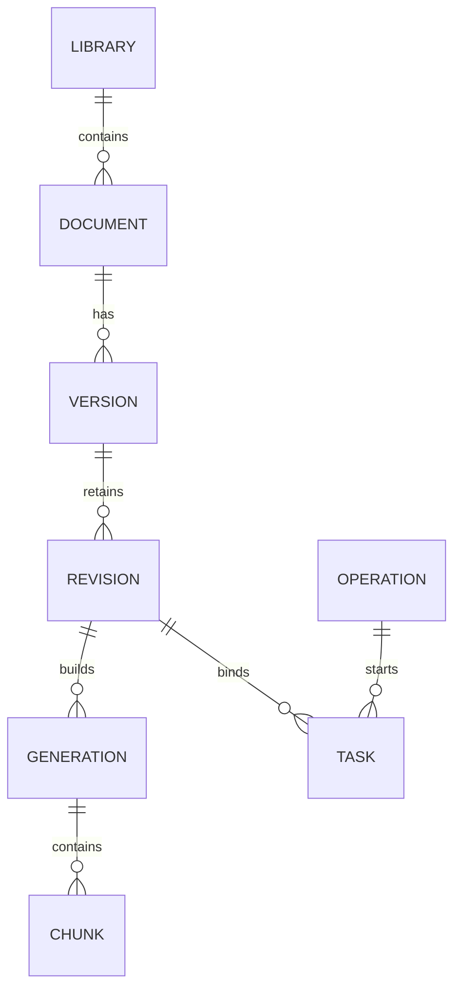

# KB-02.3 知识资料、版本、任务模型与存储隔离设计

## 解决的问题

现有全量入库会清理catalog之外的资料并替换旧分块，直接承载页面上传会影响新增资料及历史引用；现有知识表还不能分别表达草稿、确认、发布和处理失败。
本设计确定独立管理表、原件存储和版本状态边界，让后续开发可以逐项实现上传预览、候选索引、发布切换及历史回查。

## 核心作用

本设计承接KB-02.1 Java授权和KB-02.2 Python调用契约，为数据库迁移、文件接收及处理流程提供模型与约束。
资料按逻辑文档、规范版本、草稿修订及索引批次组织，操作记录绑定人工意图，任务记录保存处理结果，检索只读取当前发布指针。
Java继续裁决权限，Python依据自有知识数据执行确认、版本及状态事务；文件或外部模型调用不占用长期数据库事务。
KB-02.3阶段只形成设计文档；后续实现进度及边界见本文第九至十一节，不把整体设计视为全部已实现。

## 一、设计决定与当前事实

| 编号 | 决定 | 来源或默认值 |
|---|---|---|
| D01 | 新增独立管理与检索表，旧CLI继续使用原知识表 | 2026-10-29用户已确认 |
| D02 | 未发布草稿允许重新上传修正，每次增加修订号，旧预览和任务失效；发布后必须上传新的规范版本 | 2026-10-31用户已确认；不是在线编辑，旧任务历史记录保留，详见4.2 |
| D03 | 首版使用同一PostgreSQL实例中的Agent自有表，原件使用本地持久化目录及Docker命名卷 | 沿用现有部署；不增加对象存储、消息队列或复杂任务平台 |
| D04 | 管理库准备完成并验收后一次性切换问答源，不混查、不自动回退旧库 | D01的切换约束；知识库页与订单页使用同一服务端数据源 |
| D05 | 默认单个Agent实例负责管理任务，重启后任务明确中断且由人受控重试 | 首版部署限制，不声称已具备多实例任务调度 |

现有16份规范根据catalog中的明确替代关系归为14份逻辑资料，其中2份各有一个历史版本；不根据文件名推断关系。
旧数据仍在`knowledge_documents`和`knowledge_chunks`；旧Repository存在全局文件路径/正文哈希唯一约束、删除旧Chunk及裁剪目录外文档的行为。
旧就绪检查要求文档ID集合与固定catalog相同，不能直接用于动态管理库。现有Chunk ID由规范身份、章节、正文哈希和重复位置签名生成，不包含Embedding模型身份。

实现依据：[原模型](../../agent-service/app/models/knowledge.py)、[旧入库Repository](../../agent-service/app/repositories/knowledge.py)、[就绪检查](../../agent-service/app/services/knowledge_index_capabilities.py)、[分块身份](../../agent-service/app/knowledge/chunking.py)。

## 二、身份、不可变内容及关系

| 身份 | 含义 | 变化规则 |
|---|---|---|
| document_id | 同一份逻辑资料，串联其规范版本 | 创建后稳定，不用文件名或规范版本号充当主键 |
| version_id | 一版规范，例如同一资料的1.0与2.0 | 规范版本号在同一逻辑资料内唯一，字符串精确匹配，不作浮点比较 |
| revision_no | 未发布版本的第几次文件/元数据修订 | 从1递增；修正草稿创建新修订，原修订原件与处理历史保留 |
| generation_id | 对某个修订进行的一次索引构建 | 每次人工重试使用新批次，失败批次保留；批次内Chunk不得重复 |
| citation_document_id | 沿用现有引用格式的规范身份 | 初始纳管保留catalog document_id，新上传版本使用其稳定version_id |

新资料、版本、任务、索引批次和操作ID采用服务端生成的大写前缀加UUID大写十六进制字符，长度不超过128；UUID不用于随机化固定演示业务数据。
新索引可复用稳定Chunk算法，使用`citation_document_id`作为分块输入中的规范身份，初始纳管不重写已有Chunk ID。
同一规范版本发布后封存`published_revision_no`，重新生成向量不能改写这份正文。首版固定现有Embedding身份，模型/维度升级另行规划，不在启动时自动重建。

图中名称是下节表名的简称，展示整体目标；当前模型及上传解析实现见第九至十一节。

## 三、八张新表的职责与字段

统一使用Agent现有Alembic元数据，不创建Java业务实体或Flyway迁移。时间字段使用服务端UTC时区时间。
ID为`VARCHAR(128)`，哈希为64位SHA-256十六进制字符串，计数器为非负`BIGINT`，修订号为正整数。
下列字段是整体迁移目标；KB-02.4建立首批四表，KB-02.5补齐其余四表及版本封存关系，KB-02.6接入原件及上传解析应用。当前尚无对外管理接口或发布执行流程，实现边界见第九至十一节。

| 表名 | 职责 | 关键字段及约束 |
|---|---|---|
| managed_knowledge_libraries | 唯一内部知识库及读源切换 | `library_id=DEFAULT`单例，`source_mode=LEGACY/MANAGED`，`release_revision`，`source_catalog_hash`，创建/激活时间；不增加多知识库产品入口 |
| managed_knowledge_documents | 逻辑资料及当前发布指针 | `document_id`主键，`library_id`外键，`current_version_id`可空，`row_version`，创建人/时间；当前版本必须属于该资料 |
| managed_knowledge_versions | 规范版本及修订指针 | `version_id`主键，`document_id`外键，`specification_version`，唯一`citation_document_id`，`current_revision_no`，`published_revision_no`，`published_generation_id`，`publication_state`，来源与实际管理发布时间；唯一`(document_id, specification_version)` |
| managed_knowledge_revisions | 每次上传的不可变原件及元数据快照 | 联合主键`(version_id, revision_no)`，原件key/文件名/格式/字节数/raw_hash，正文快照及normalized_hash，metadata_hash、业务元数据、创建人/时间；原件key唯一，解析结果仅允许由空写入一次 |
| managed_knowledge_index_generations | 修订对应的索引批次 | `generation_id`主键，版本/修订外键，Provider、模型、1536维度、index_version、分块策略版本及输入哈希，`build_method=GENERATED/COPIED_LEGACY`、`state=BUILDING/READY/FAILED`和时间；批次输入不可变 |
| managed_knowledge_chunks | 某索引批次的检索正文与向量 | 联合主键`(generation_id, chunk_id)`，章节路径、顺序、正文、正文哈希、词元数、全文检索字段及VECTOR(1536)；唯一`(generation_id, chunk_index)`，新增本表独立GIN与HNSW索引 |
| managed_knowledge_tasks | 解析/索引任务的输入与结果 | `task_id`，`operation_id`，`task_type=PARSE/INDEX`，版本/修订/可空索引批次，状态、owner_id、attempt_no、retry_of_task_id、Trace及时间、受控错误码；同一操作的同类任务不重复，单一修订同类任务只能有一个排队或执行中实例 |
| managed_knowledge_operations | 人工动作、幂等、确认及审计 | `operation_id`，actor、Java动作、目标类型/ID、幂等键、input_hash、confirmation_snapshot、状态、结果身份/受控错误码及时间；唯一`(actor_id, action, idempotency_key)`，不保存Token或整篇正文 |

### 3.1 元数据与来源

每个修订保存标题、document_type、satellite_type、product_type、processing_level、specification_version、effective_date、expiry_date及permission_scope；使用显式类型字段参与SQL过滤，不能只藏在任意JSON中。
版本号与所属version行一致，日期满足失效日不早于生效日。元数据哈希覆盖这些业务字段，由服务端按规范化JSON计算，不能相信调用方自报哈希。
来源保存`CATALOG_IMPORT/UPLOAD`、可空原catalog document_id、catalog快照哈希及原生命周期/替代关系；导入按明确替代边分组，不能猜测文件名。

旧catalog的`ACTIVE/HISTORICAL`是来源信息，不直接承担新库发布状态。旧版被新版本替代时，不补造规范失效日，也不把停用伪装成规范失效。
旧作者/发布时间无法核实时保留未知；新管理库的导入时间、操作人和发布时间只记录实际发生的管理操作。

### 3.2 关系及唯一性

- `current_version_id`通过`(document_id, version_id)`组合外键绑定所属资料；版本的发布索引必须通过版本/修订/批次组合关系绑定本版本封存的修订。
- 在version表显式增加`UNIQUE(document_id, version_id)`，在generation表增加`UNIQUE(version_id, revision_no, generation_id)`，作为上述组合外键的合法引用目标。
- version的`current_revision_no`为必填正整数，`(version_id, current_revision_no)`指向修订的循环外键使用`DEFERRABLE INITIALLY DEFERRED`，允许同一事务先插版本再插修订，但提交时不得悬空。
- 通过部分唯一索引限制每份逻辑资料最多一个`PUBLISHED`版本；指针、发布状态和索引READY的跨行一致性由Repository事务保证，不能声称单个CHECK已覆盖跨表语义。
- 原件raw_hash、normalized_hash及metadata_hash不作跨版本全局唯一约束；允许只改元数据或版本号而正文相同。幂等和版本唯一约束负责重复请求保护。
- 复用单份资料的读取、规范化和分块能力，不把新库所有历史版本送入旧catalog的跨文档重复检测器，也不套用旧表的全局正文唯一约束。
- 同一Chunk ID在不同索引批次可出现，但必须代表同一规范身份、章节及正文；联合主键让历史索引共存，默认检索只选择发布批次。
- 创建表时先建立主体再补充循环指针外键；先插入空发布指针的资料，再插入版本、修订和批次，最后更新指针，不改已有迁移。

## 四、状态、草稿修正与确认事务

### 4.1 状态定义

| 对象 | 状态 | 规则 |
|---|---|---|
| 规范版本 | DRAFT、PUBLISHED、SUPERSEDED、DISABLED、HISTORICAL | DRAFT只供预览；PUBLISHED且为当前指针才可检索；SUPERSEDED表示曾发布后被替代；DISABLED表示主动停用；HISTORICAL仅承接初始历史来源 |
| 索引批次 | BUILDING、READY、FAILED | READY表示索引完整，不等于已被发布；未被发布指针引用的批次不进入问答 |
| 任务 | QUEUED、RUNNING、SUCCEEDED、FAILED、INTERRUPTED、STALE | STALE表示目标修订或确认条件已变化，INTERRUPTED表示进程重启；旧失败历史不覆盖 |
| 人工操作 | CONFIRMED、EXECUTING、SUCCEEDED、FAILED、STALE | 创建于明确用户操作，CONFIRMED不是模型推断；发布中不提前标记成功 |

发布前必须满足解析成功、索引READY、修订匹配、权限允许、确认匹配及元数据有效。首版拒绝将未来生效或已过期版本发布为当前依据；已发布后到期的资料由检索日期过滤排除，不自动修改原规范日期。
被替代或停用的版本不能重新变成DRAFT；首版不提供恢复旧版发布或永久删除。
最终模型中，DRAFT的发布修订/批次指针必须为空，PUBLISHED/SUPERSEDED/DISABLED必须具有封存修订及批次，且封存修订等于该版本最后修订；HISTORICAL仅允许CATALOG_IMPORT来源，历史封存批次不表示曾在新平台实际发布。
PARSE任务不绑定generation，INDEX任务必须绑定generation；READY批次必须经完整Chunk数量、身份与向量校验，跨行完整性由事务内读取和条件更新验证。

### 4.2 未发布草稿重新上传

草稿修正仍通过上传文件完成，不提供在线正文编辑。只有DRAFT允许修正，规范版本号保持；修改规范版本号需新建version。
新上传创建`revision_no+1`的原件及元数据快照，原修订不覆盖，并在短事务中按预期document.row_version和current_revision_no切换草稿指针。
旧修订的预览、确认输入和执行中的任务不再适用于发布；排队或执行中的旧任务标记STALE，已完成任务的历史结果保留并注明所属修订。
旧任务迟到结果必须再次核对任务状态、owner_id及当前修订，不能写入新修订、移动发布指针或将旧预览标为当前。
已发布版本的重新上传一律要求新的规范版本；不会因修正草稿而改写已发布规范。

### 4.3 人工操作与幂等

UPLOAD、PUBLISH、DISABLE、RETRY_INDEX沿用KB-02.1动作，不新增Java动作。上传提交本身是明确人工操作，发布/停用/重试分别确认，不能复用模型建议或业务Review Approval。
确认快照使用服务端事实，绑定actor、action、library/document/version、revision_no、正文及元数据哈希、预期资料row_version、原发布指针和需要时的目标task/generation；不存凭据或无关上下文。
同一actor/action/幂等键和相同input_hash重放返回原操作/任务，载荷不同则冲突；新幂等键也不能突破版本唯一及同修订任务并发限制。
唯一约束处理首次并发，条件更新处理执行权；创建/推进操作、任务和指针的事务失败全部回滚。
UPLOAD操作成功表示原件、修订和解析任务已持久化，不等于解析成功；解析结果单独看task。PUBLISH须在实际切换发布指针后才成功，DISABLE须在指针清空后才成功。

### 4.4 发布与停用时序

1. 读取当前候选与资料事实生成预览；用户确认后调用Java校验对应动作，外部HTTP不放在数据库长事务中。
2. 在短事务中重新核对候选、修订、哈希和预期row_version，保存确认快照及幂等记录，预留新的执行row_version；没有匹配的READY索引时创建索引任务，已有完全匹配批次时复用并跳过向量构建。当前已发布指针保持可用。
3. 事务外构建向量，结果只绑定该任务、修订和索引身份。全部批次校验成功后才准备保存完整Chunk集合，不把半批数据标为READY。
4. 构建结束后先在事务外再次调用Java检查PUBLISH权限，再在最终短事务重新校验任务执行权、修订、预留row_version及确认快照；写入完整Chunk并将批次标READY，先把旧版本标SUPERSEDED，再发布新版本、切换指针、递增library.release_revision并完成任务/操作。
5. 任一条件变化或构建失败，旧发布版本不变。不能把Java早先授权或Embedding成功当成最终执行成功。

停用不调用Embedding：Java授权后在同一短事务核对目标为当前发布版本及row_version，设置DISABLED、清空当前版本指针、递增发布修订并保存操作结果。
停用后不自动恢复更旧版本，旧原件及Chunk继续用于已存在引用的回查。
执行中的身份上下文只在当前任务内存持有，数据库不保存Token；权限拒绝、凭据过期或Java不可用均停止最终发布，重启后必须由用户携带新的有效身份重新发起操作。

## 五、原件持久化与失败处理

KB-02.6已增加`KNOWLEDGE_STORAGE_ROOT`配置，本机默认解析为仓库根的`.local/knowledge-storage/`，Compose显式设为`/var/lib/productline-agent/knowledge`并挂载`knowledge-data`命名卷。
显式配置须为不含父级跳转的绝对路径；POSIX存储适配器拒绝目录链中的符号链接。默认目录已加入.gitignore，构造服务不创建目录，只有实际上传才惰性创建；本批没有重建容器或修改现有运行卷。

原件key固定为`versions/<version_id>/revisions/<revision_no>/original.md`或`original.txt`；客户端文件名只作展示，不参加目录拼接。
默认单文件最多10MiB，按流累计字节限制；只接受MD及UTF-8 TXT，解析校验编码与空内容，不展开压缩文件。
保留原字节及raw_hash；规范化正文另存数据库，normalized_hash使用现有BOM/换行规则，不能拿原字节哈希替代规范化内容哈希。

先写受控临时文件，完成长度/格式/编码/哈希检查，再原子创建最终原件入口并提交数据库引用。KB-02.6采用同文件系统硬链接创建及临时入口清理，避免普通改名覆盖已存在原件；最终入口创建后再次校验字节并同步目录。读取时按ID查库定位key，拒绝绝对路径、`..`及符号链接，物理路径不对外返回。
文件系统与数据库不构成同一事务：文件提交成功而DB失败时可能留下未引用文件。首版保留在受控目录，不自动删除、不纳入检索，排查通过脱敏操作身份进行；后续清理必须另设明确范围和审批。
读取原件缺失或校验失败时返回明确错误，不拿另一版或仓库文件冒充。DB中的既有引用原文不因原件下载失败而改写，备份恢复需同时覆盖数据库与原件卷。

## 六、任务中断与重试

首版单个管理任务实例使用进程唯一owner_id，以QUEUED→RUNNING条件更新领取任务；同修订同类任务的部分唯一约束防止并发重复启动。
管理服务激活时将旧owner的QUEUED/RUNNING任务记为INTERRUPTED，并记录受控原因；不自动执行外部模型或继续未完成的索引构建。KB-02.6的`start`可显式调用，也会在首个已授权管理调用时惰性运行；普通FastAPI启动只装配对象，不要求现有运行库已迁移。
对应尚未结束的发布/索引重试操作记为FAILED，保留中断原因；已成功接收文件的UPLOAD操作不改写为失败，其解析任务单独显示中断。
INDEX任务的人工重试必须重新校验Java RETRY_INDEX权限及目标修订，创建新操作、新task和新generation，通过retry_of_task_id保留原失败，不把原失败记录改成成功。
RETRY_INDEX只构建READY候选，不自动发布；成功后需要新的PUBLISH确认和Java权限检查才能切换指针，不复用原失败发布的授权。新发布可以复用该READY批次，不重复生成向量。
PARSE失败或中断通过UPLOAD重新上传修正草稿、生成新修订和解析任务，不借用RETRY_INDEX权限，也不新增未约定的Java动作。
旧修订或已不适用目标不能重试；新任务输入始终来自保留的不可变修订，不信任客户端提交的正文、状态或路径。
错误记录仅含内部白名单错误码、阶段、Trace及时间，不保存凭据、绝对路径、正文或供应商原始异常。
多实例租约、自动故障接管及跨实例队列不在本版，不能将单实例重启处理描述为已具备分布式恢复能力。

## 七、初始纳管、统一切源与就绪检查

### 7.1 初始16版本纳管

未来通过显式运维入口执行，要求明确人工确认并调用Java检查UPLOAD/PUBLISH权限，应用启动不纳管、不调用Embedding。
按catalog的替代关系建立14个逻辑document和16个version，各建立revision 1；14个当前版本准备为PUBLISHED，2个历史版本为HISTORICAL，保留原日期、类型、权限、替代关系和引用规范ID。
复制原件及既有80个Chunk/向量前，校验源文件、规范化正文、章节、Chunk身份、catalog快照和完整Embedding身份一致；`build_method=COPIED_LEGACY`记录复制来源，不能冒充重新调用了模型。
任一数据缺失或不匹配时停止，不隐式付费补齐、不删除旧数据。纳管过程可在源快照不变时重放，不重复建立资料、版本或批次；来源不同则冲突，不覆盖已纳管历史。
导入实际时间、操作人、任务和新的管理发布时间记录实际值；旧规范原发布人/时间未知时仍为空，不伪造旧平台发布记录。

### 7.2 数据源统一切换

新singleton起始为LEGACY，现有CLI、固定测试及问答继续用原表。管理库准备完成前，草稿可预览，但公共发布/停用不作为线上已生效操作；初始纳管是受确认的内部准备流程。
全部纳管数据及索引验收后，由独立人工操作再次校验Java PUBLISH权限及源快照，在短事务将source_mode改为MANAGED并递增release_revision。
知识库问答与订单规范检索从同一服务端选择器取得模式；MANAGED只使用新表，LEGACY只使用旧表，不合并候选或在故障时静默切回旧表。
首版不提供MANAGED→LEGACY的反向切换，避免停用资料或新发布规则被旧库重新放行。旧CLI仍可维护旧表，但不能更新、裁剪新表或影响MANAGED发布集合。

### 7.3 检索、就绪和历史引用

新Repository按document当前版本指针、version封存修订和发布generation关联Chunk，先应用权限、产品、卫星、处理级别、版本及日期条件，再执行TopK。
查询Embedding生成在读取检索数据的短事务前完成；一次检索的source_mode、release_revision、发布指针与关键词/向量候选在同一REPEATABLE READ快照内读取，生成答案不持有该事务。
引用继续保留规范ID、规范版本、章节、Chunk ID及原文，历史版本和索引不被新构建覆盖。后续Run策略快照补充数据源模式、发布修订与实际索引身份，不能重写旧Run中未记录的字段。

新就绪检查依据实际发布集合及完整索引身份，不再比较固定16个catalog ID；草稿、历史、失败批次不占用发布集合的完整性统计。
所有资料停用时发布计数为0，`ready=false/NOT_INDEXED`并明确“无已发布资料”，不回退旧库。新计数契约必须允许0，并同步Python/前端Schema及测试，不能直接套用旧`expected_document_count>0`约束。
就绪代表索引可用，不保证当前问题有适用证据；过期资料仍由检索日期条件排除。现有关键词零召回和最终回答质量问题不会因表结构改变而自动解决。

## 八、后续开发切分与验收

| 任务 | 最小交付 | 停止线 |
|---|---|---|
| KB-02.4 | 新资料、版本、修订Schema/ORM和增量迁移，先建立library/document/version/revision四表及约束 | 迁移、引用关系、状态输入和并发约束可在隔离数据库验证；不接上传或线上迁移 |
| KB-02.5 | 操作/任务/索引批次/Chunk四表及约束，补齐循环引用与任务关系 | 管理模型完整，失败/重复/并发关系验证通过；不实现后台模型调用 |
| KB-02.6 | 原件存储适配及上传/解析应用服务 | 路径、大小、编码、修订替换和DB失败孤儿文件有明确行为；草稿不进问答 |
| KB-02.7 | 只读管理接口：资料列表、详情、版本及任务查询，接入READ授权 | 身份/范围过滤和脱敏结果可验证，不同时建设上传接口或页面 |
| KB-02.8 | 上传与草稿修订HTTP接口，复用KB-02.6应用 | 文件提交、幂等和失败响应可验证，不同时建设发布或页面 |
| KB-02.9 | 正文与分块预览HTTP，复用KB-02.6应用 | READ授权、当前/历史修订和失败响应可验证，不同时建设发布或页面 |
| KB-02.10 | 原件读取HTTP接口 | 授权、资料归属、下载响应及完整性错误可验证；随后收口KB-02验收，不自动扩建发布或页面 |
| KB-03 | 索引执行、确认发布、停用、初始纳管及统一切源 | 原有KB-03停止线不变，按可测试小任务分别验收 |

循环外键分两次迁移建立：KB-02.4先建立资料→版本→修订及当前版本归属约束，仅开放DRAFT数据持久化；依赖generation的发布指针字段及状态约束到KB-02.5随新表、归属外键和索引一起加入，不先接受悬空批次ID。
迁移必须基于实施时真实Alembic head新增，不预先承诺固定迁移编号；不修改0014及此前迁移，也不把设计文档当作已执行迁移。

验收用例包括：同版本草稿修订替换与旧任务迟到、已发布版本不可改、同正文不同版本合法、幂等重放/冲突、两个发布并发、构建失败保留旧版、停用不回退、原件丢失/越界、重启不自动付费、旧CLI只影响旧表、初始14资料/16版本关系与原引用保留、切源后无混查、零发布资料的就绪状态，以及ORDER-003黄金链路回归。

KB-02.3验收只核对文档、关系、固定资料映射及当时的相关局部回归，不新增已实现的Agent面试关注点或功能里程碑记录；后续实现按下节范围及STATUS.md记录。

## 九、KB-02.4 首批Schema、ORM与迁移

### 解决的问题

只有设计文档时，资料、版本及修订仍无法持久化，也无法验证同一规范版本重复写入、修订指针悬空或跨资料引用等错误。
本任务建立独立基础表及严格内部快照，先让这些关系和失败回滚在数据库中可验证，为后续管理应用提供数据底座。

### 核心作用

本阶段承接Java授权与Python授权Client，定义内部知识库、资料、规范版本和修订的输入边界，由数据库保存关系、原件定位信息和元数据快照。
Schema拒绝非法状态、格式、日期、来源及不匹配的正文哈希；组合外键、唯一约束和延迟外键约束分别保护归属、重复版本和同事务创建版本/修订。
当前没有对外管理接口或Repository操作，授权仍须由后续应用在执行前调用Java，模型和页面不能借这些内部记录获得权限。

### 已实现范围

- [内部Schema](../../agent-service/app/schemas/managed_knowledge.py)：`ManagedKnowledgeLibraryState`、`ManagedKnowledgeDocumentState`、`ManagedKnowledgeDraftVersion`、`ManagedKnowledgeMetadata`及`ManagedKnowledgeRevisionSnapshot`。内部快照拒绝额外字段；元数据哈希由`metadata_digest`按固定JSON计算，覆盖业务字段、演示标识、维护主体和变更说明，不接受自报`metadata_hash`。
- [四表ORM](../../agent-service/app/models/managed_knowledge.py)：library/document/version/revision。规范版本号在同一资料内唯一，引用身份及原件key唯一；原件和正文哈希没有跨版本唯一限制。修订中的规范版本号通过组合外键与版本行一致。
- [0015增量迁移](../../agent-service/migrations/versions/0015_managed_knowledge_drafts.py)：基于`0014_review_source_run`新增四表、循环外键和`DEFAULT`库记录。该记录固定`LEGACY`且未激活；版本仅允许`DRAFT`，不导入固定语料、不修改旧表、不切换问答源。降级仅移除本迁移新增对象。
- 版本指向当前修订的外键为`DEFERRABLE INITIALLY DEFERRED`：允许同一事务先插版本再插修订，提交时没有对应修订则整笔回滚。`current_version_id`只校验资料归属，发布指针与状态的跨行一致性仍由后续发布事务负责。
- 正文快照保留规范化后的首尾空白；正文与规范化哈希必须成对，并核对实际SHA-256。原件字节哈希需要后续文件接收器计算，本阶段不接收或读取实际上传文件。

### 验收入口及后续边界

`make test-knowledge-models`包含新旧Schema测试及隔离PostgreSQL测试。新增持久化测试在独立数据库中以旧表哨兵验证`0014→0015→0014→0015`，并核对四表与ORM一致、外键、唯一约束、回滚和真实锁竞争；同一入口既有持久化测试继续验证完整旧迁移链及旧检索行为。
也可向专用测试PostgreSQL配置`AGENT_PERSISTENCE_TEST_DATABASE_URL`，在agent-service执行`.venv/bin/pytest -q tests/knowledge/test_managed_knowledge_persistence.py`；测试只迁移自行创建的临时库，连接用户须能创建/清理测试库。

快照冻结仅约束Schema对象；数据库字段不等于已具备业务不可变保护。修订号连续递增、原件落盘、解析结果只写一次、旧任务失效、操作幂等和封存均待应用服务实现。
KB-02.4验收时未增加Java/前端接口、文件目录/卷、后台任务或模型调用，发布修订及索引批次字段当时不存在；后续KB-02.5范围见第十节。KB-02.4不新增Agent面试关注点。

## 十、KB-02.5 操作、任务、候选索引与封存关系

### 解决的问题

首批四表不能保存人工操作、处理失败和重试关系，也无法区分已构建的候选索引与已封存的规范证据。
本任务补齐处理模型及数据库关系，让后续服务有地方保存幂等身份、确认快照、任务进度和历史分块，避免重复任务及跨版本引用。

### 核心作用

本阶段在资料、版本和修订之后接入操作、任务、索引批次及分块，输入为严格内部记录，输出为可验证的持久化关系。
确认记录绑定用户、动作、目标修订及哈希，任务关联操作、修订和重试来源；候选批次保留索引身份，分块按批次共存，规范版本通过组合外键引用本修订的封存批次。
数据库只保护已定义的结构和并发约束；Java授权、人工意图核验、文件及模型处理、重启恢复和最终发布事务仍须由后续应用实现。

### 已实现范围

- [处理Schema](../../agent-service/app/schemas/managed_knowledge_processing.py)：`ManagedKnowledgeConfirmation`、`ManagedKnowledgeOperationRecord`、`ManagedKnowledgeTaskRecord`、`ManagedKnowledgeGenerationRecord`和`ManagedKnowledgeChunkRecord`，拒绝额外字段及凭据/正文载荷；校验操作与快照身份、状态/时间/错误组合、重试输入、正文哈希及有限非零1536维向量。
- [处理ORM](../../agent-service/app/models/managed_knowledge_processing.py)：操作、任务、索引批次及Chunk四表，与首批四表共同构成八表管理模型。没有任务调度器、Repository或外部调用。
- 操作统一以规范版本为目标，保存`target_type=VERSION`及`target_id=version_id`；RETRY_INDEX的原任务在严格确认快照和新任务的`retry_of_task_id`中保存。KB-02.5只提供幂等键唯一约束；KB-02.6已接入UPLOAD同载荷重放和不同载荷冲突，其他动作仍待后续服务。
- 确认快照采用JSONB，Schema限制固定字段；数据库检查身份绑定、关键字段及键白名单，拒绝JSON空值身份或附加Token字段。该记录不等于已验证Java权限或已核实知识事实，执行前仍须重读自有数据并复查权限。
- 任务通过组合外键绑定同一版本/修订的操作及批次，原重试任务必须属于同一修订、同一类型；同一操作同类任务唯一，同一批次只关联一个索引任务。部分唯一索引限制同修订同类任务最多一个QUEUED/RUNNING实例；失败、中断和失效历史可保留。
- 原件解析任务仅允许UPLOAD且不绑定generation；索引任务仅允许PUBLISH/RETRY_INDEX并绑定generation。RETRY_INDEX必须指向原任务并使用新的attempt_no，原任务是否可重试及次数连续性仍由后续应用复核。
- 候选批次保存Provider、模型、1536维度、索引/分块版本、输入哈希及构建来源；READY要求正分块计数和完成时间，FAILED保存受控原因。实际数量、分块身份及向量完整性属于跨行校验，尚未实现。
- Chunk使用`(generation_id, chunk_id)`联合主键及批次内顺序唯一约束；不同批次可保留相同稳定Chunk身份，新增独立GIN和HNSW索引。内部快照保留元组不可变性，写入pgvector时转换为列表；现有测试使用`model_dump(mode="json")`，后续Repository须做同等转换。
- [版本状态Schema](../../agent-service/app/schemas/managed_knowledge.py)新增`ManagedKnowledgeVersionState`，保留上传入口专用的`ManagedKnowledgeDraftVersion`；后者仍拒绝自报发布状态。版本增加封存修订、批次和实际管理发布时间，HISTORICAL仅允许历史catalog来源且不伪造发布时间。
- [0016增量迁移](../../agent-service/migrations/versions/0016_managed_knowledge_state.py)基于0015，扩展发布状态及行内封存约束，增加同资料最多一个PUBLISHED版本的部分唯一索引，并通过版本/修订/批次组合外键防止引用其他版本的批次。0015及此前迁移保持原样。

### 验收与后续边界

`make test-knowledge-models`覆盖新旧Schema、八表与ORM一致性、非法输入、并发幂等键/活动任务排他、失败重试、历史分块共存及发布引用失败时原指针保留。
增量迁移可在隔离库升级/降级；0016降级前要求所有版本仍为DRAFT，有封存版本时整个降级事务失败，保留证据，不自动转换或抹去发布历史。

本批仍固定LEGACY读源，不执行资料纳管或问答切源。数据库外键不能证明候选READY、发布指针与状态一致、权限有效或确认仍适用；也没有禁止所有直接SQL修改的封存触发器，不能据此宣称发布闭环已完成。
KB-02.5验收时以上处理流程尚未接入；KB-02.6交付见第十一节，发布与停用执行仍待后续任务。KB-02.5不新增Agent面试关注点。

## 十一、KB-02.6 原件、上传修订与解析应用

### 解决的问题

只有八表模型时，真实文件仍无法安全保存，重复上传、草稿修正和迟到解析也缺少事务边界。
本任务把Java授权、独立原件和确定性解析接成内部应用服务，让接收结果、失败记录、旧修订及原文回查能够验证。

### 核心作用

上传输入为明确文件提交、业务元数据和可选目标快照；Java裁决UPLOAD权限，Python在短事务中复查资料、规范版本及修订，交付草稿/操作/任务身份。
文件写入及解析放在事务外，解析结果提交前再次检查owner、任务状态、当前修订和正文是否已写入；预览和原件读取分别验证READ权限。
该服务没有对外路由或Agent Tool注册，不生成向量、不切换LEGACY问答源、不发布规范，也不能让文档授予业务操作权限。

### 输入和处理约定

| 操作 | 命令目标 | 约束 |
|---|---|---|
| 新资料 | 无document/version及预期计数 | 服务端生成资料/版本身份及revision 1 |
| 已有资料新增规范版本 | document_id和expected_row_version | 同资料规范版本号唯一，原发布指针不变 |
| 修正未发布草稿 | document_id、version_id及预期资料计数/修订号 | 仅DRAFT且规范版本号保持，接收成功才创建revision_no+1 |

- [上传Schema](../../agent-service/app/schemas/knowledge_management.py)拒绝调用方提交原件key、正文哈希或发布状态；文件名只作展示，拒绝目录分隔符及控制字符。演示标识、维护主体及权限范围沿用已确认元数据契约，操作人使用本次Java授权的实际用户。
- [原件适配器](../../agent-service/app/knowledge/storage.py)逐级使用目录描述符与NOFOLLOW，流式累计10MiB上限，校验UTF-8、非空和数据库不能保存的NUL字符。非法格式、大小、编码或空文件在接收前拒绝并清理临时文件，不改变原草稿或产生新修订。
- [上传服务](../../agent-service/app/services/knowledge_management.py)每次重新检查Java权限，幂等重放也不能复用旧授权。输入哈希覆盖文件原字节身份、文件名、元数据及目标快照；相同用户/UPLOAD/幂等键同输入返回原操作及任务，不同输入明确冲突。
- [事务Repository](../../agent-service/app/repositories/managed_knowledge.py)用幂等键事务锁及唯一约束保护重复提交，锁定资料后复查row_version、当前修订、DRAFT状态及规范版本号。接收事务保存修订、UPLOAD成功记录与PARSE任务，递增资料计数；旧排队/运行任务及待执行发布意图失效，旧完成结果不覆盖。
- [单份解析](../../agent-service/app/knowledge/managed_parsing.py)复用已有BOM/换行规范化、Markdown标题校验和稳定分块。分块输入只要求引用身份与标题，不补造旧catalog的ACTIVE或有效期，不调用跨文档重复检测器；同正文不同版本合法。
- 成功接收后，在独立事务领取当前owner的PARSE任务，事务外解析，最后原子写入正文/normalized_hash及任务成功状态；正文只由空写入一次。Markdown必须以与元数据匹配的一级标题开始，失败保留草稿、原件和PARSE_FAILED记录，UPLOAD仍表示接收成功。
- 修订变更、任务失效、owner变化或管理服务中断后，迟到结果不能覆盖当前正文。明确启动或首次授权管理调用将旧owner未完成任务标INTERRUPTED，未完成发布/索引重试操作及构建批次标失败；不重写成功UPLOAD，不自动执行旧任务或调用模型。
- 服务提供带修订及资料计数的正文/分块预览和授权原件读取。旧预览可历史回查并标记非当前修订，不等于有效发布确认；分块仅在内存中预览，不写向量或检索表。原件缺失/摘要不符明确失败，既有数据库原文不被其他文件替代。

### 文件与数据库失败边界

文件与PostgreSQL不共事务。原件入口创建而数据库提交失败时保留未引用文件，返回KNOWLEDGE_PERSISTENCE_UNAVAILABLE，不自动删除或纳入检索。
同一版本/修订路径再次上传相同字节可以校验复用；不同字节返回ORIGINAL_CONFLICT。此时可先以原文件重试完成接收，再上传下一修订，或新建规范版本，不能默默覆盖孤立原件。清理仍须另行明确范围。
数据库失败与解析失败分别处理；取消不会伪装成成功，已领取任务保留执行中事实供管理服务重新激活时标中断。

| 结果或错误码 | 含义 |
|---|---|
| UNSUPPORTED_FORMAT / FILE_TOO_LARGE / INVALID_ENCODING / EMPTY_DOCUMENT / INVALID_TEXT_CONTENT | 接收前拒绝，原草稿保持 |
| IDEMPOTENCY_CONFLICT | 同一幂等键携带不同输入 |
| STALE_DOCUMENT / STALE_REVISION / SPECIFICATION_VERSION_CONFLICT | 资料快照、当前修订或规范版本不匹配 |
| SEALED_VERSION_REQUIRES_NEW_VERSION | 已发布或其他封存版本不能重新作为草稿修改 |
| PARSE_FAILED / STORAGE_ERROR | 任务解析或原件访问失败，不等于上传记录应被删除 |
| PREVIEW_NOT_READY | 尚无可信解析正文，不能伪装空预览成功 |
| ORIGINAL_NOT_FOUND / ORIGINAL_INTEGRITY_ERROR / ORIGINAL_CONFLICT | 原件缺失、校验失败或禁止覆盖 |

### 装配、验证与后续边界

FastAPI lifespan仅装配`knowledge_management_service`，不主动查询Java、读取原件、创建目录或启动工作任务；现有健康检查无须先迁移新表。管理服务激活前必须已显式执行已有0015/0016迁移，本批没有新增迁移或部署。
`make test-knowledge-management`验证离线文件及解析边界，再用隔离PostgreSQL和真实授权Client/模拟Java响应验收应用；真实Java联调、HTTP管理路由及真实进程/容器重启仍待后续阶段。
共享数据库夹具只迁移自动创建的测试库；mypy配置显式命名空间，使测试辅助模块与Python导入路径一致，不改变运行模块加载。
下一最小任务为KB-02.7只读管理接口。当前仍是单管理实例、无分布式租约、无后台模型/索引任务执行、无发布或停用接口，也没有旧版本恢复发布及永久删除。

## 十二、KB-02.7 资料、版本和任务只读管理接口

### 解决的问题

内部上传应用已保存资料、草稿修订和任务，管理端仍无法通过HTTP查看处理结果，也不能直接把数据库记录作为页面响应。
本任务补充经过Java授权、范围过滤和字段白名单处理的只读接口，让后续页面能够安全查询资料及失败记录。

### 核心作用

接口接收演示身份、资源ID及分页条件，每次调用Java READ授权，再由独立只读Repository查询Python自有管理表并返回元数据和任务事实。
权限范围只来自授权响应，不接受页面自报范围；不存在、范围不匹配及版本归属错误统一返回404。
GET不激活上传服务、不恢复或领取任务、不读取原件、不生成向量，也不切换现有规范问答的数据源。

### 已实现接口及输入输出

以下路径均以`/api/agent/knowledge`为前缀：

| 方法 | 路径 | 输出 |
|---|---|---|
| GET | `/documents` | 资料摘要分页，每份资料附最新可访问规范版本 |
| GET | `/documents/{document_id}` | 单份资料摘要、row_version及最新可访问规范版本 |
| GET | `/documents/{document_id}/versions` | 规范版本元数据分页，包括草稿、停用及历史状态 |
| GET | `/documents/{document_id}/versions/{version_id}` | 指定资料下的版本元数据，校验归属 |
| GET | `/documents/{document_id}/tasks` | 资料所属处理任务分页，保留旧修订的完成及失败记录 |
| GET | `/tasks/{task_id}` | 指定任务的状态、修订、耗时所需时间点及受控错误 |

- 身份沿用`X-User-Id`、`X-User-Role`及可选Bearer Header，Java校验REVIEWER演示角色；没有新增生产认证或复杂权限平台。
- ID沿用管理库的大写前缀与32位十六进制格式。分页默认`page=1/page_size=20`，页码上限1000000，每页1～100项；越界或非法格式返回422。
- 资料及版本按版本创建时间倒序、版本ID倒序稳定排列；资料选取最新可见版本，不按规范版本字符串排序，也不将它称为当前发布版本。
- 范围过滤先于去重、总数统计和分页；空库返回`items=[]/total=0`，越过末页保留真实总数。子列表的父资料不可见时返回404，不伪装为空集合。
- 资料/版本查询依据当前修订的权限；任务依据其所属修订的权限，并返回`is_current_revision`。任务按创建时间及任务ID倒序；计数与条目在同一REPEATABLE READ事务快照中读取，不加行锁。
- 版本只返回明确业务元数据、显示文件名、大小、格式、解析是否完成和发布状态；不返回正文、原件key、哈希、内部索引批次、操作者身份或确认快照。历史正文与原件仍由后续HTTP任务接入。
- 任务错误码采用受控映射和固定文案；未知历史错误统一为`PROCESSING_FAILED`，不复制异常原文。`retry_available=false`表示本批没有可执行重试接口，不能当作状态已满足重试条件。

### 错误、验证与后续边界

错误结构统一为`trace_id/code/message`：缺失或非法身份401、Java拒绝403、不可见资源404、授权超时504、其他授权不可用或非法响应502、知识查询/数据校验失败503。
每次GET重新授权，权限撤销后不复用上次成功结果；授权调用结束前不打开SQL会话，授权失败不回退旧库。查询不依赖Embedding或回答模型配置。

`make test-knowledge-management`包含HTTP身份/参数/失败测试，以及真实隔离PostgreSQL中的上传后查询、分页、未来草稿/停用版本、过期修订任务、权限范围、跨资料版本、任务不变性和LEGACY保护验证。
测试使用真实授权Client及模拟Java响应；真实Java HTTP联调、部署和真实进程重启仍待后续验收。本批无新增迁移，也不修改固定16份语料或catalog。
当前KB-02管理底座尚未整体验收，下一最小任务为KB-02.8上传与草稿修订HTTP接口；不自动推进发布、索引或页面。

## 十三、KB-02.8 上传及草稿修订HTTP接口

### 解决的问题

只读管理接口能展示资料，但用户仍无法通过HTTP提交文件或修正解析失败的草稿；直接接受页面自报的版本、状态或原件位置会绕过已有保护。
本任务将明确的文件提交接入上传应用，补齐有界文件接收、版本归属、并发快照与幂等结果的HTTP契约。

### 核心作用

接口先以演示身份向Java查询UPLOAD授权，再解析一个文件和一份JSON命令；完整接收后由KB-02.6应用再次授权，并执行既有原件保存、知识事务及确定性解析。
资料/版本身份来自路由、文件名来自上传文件、幂等键来自Header，调用方只能填写业务元数据和预期快照，不能授予权限、直接发布或覆盖封存正文。
预检和提交授权各自复用既有Client的有界重试；接口不缓存授权、不重试整个上传，也不增加后台模型或索引执行。

### 请求、结果和失败边界

前缀均为`/api/agent/knowledge`，三个接口共用`KnowledgeUploadHttpCommand`和`KnowledgeUploadResult`：

| 方法与路径 | JSON command中需提供 | 作用 |
|---|---|---|
| POST `/documents` | `metadata`，不提供预期快照 | 新资料及第一个草稿版本 |
| POST `/documents/{document_id}/versions` | `metadata`、`expected_row_version` | 已有资料新增规范版本，规范版本号不能重复 |
| POST `/documents/{document_id}/versions/{version_id}/revisions` | `metadata`、`expected_row_version`、`expected_revision_no` | 仅修正该资料的DRAFT，规范版本号保持不变 |

- Header沿用演示身份及可选Bearer，新增必填`Idempotency-Key`：1～128位，仅字母、数字、点、下划线、冒号及短横线，首位必须为字母或数字。每个新操作使用新键，重试保留原键、命令和文件字节。
- 请求必须是`multipart/form-data`，恰好一个`command`文本字段和一个带显示文件名的`file`文件字段。command为UTF-8 JSON，业务元数据沿用内部严格Schema；拒绝额外字段、重复JSON键和不可编码文本，路径ID不能由JSON覆盖。
- 原文件上限10MiB，command上限16KiB，请求总量上限10MiB+64KiB。Content-Length只做预检查，实际流逐块累计，缺少或伪造长度不能绕过限制；每个请求最多一个文件/文本字段。
- 使用新增且锁定的`python-multipart`和既有Starlette解析器，可能先使用内存、再暂存到系统临时目录；接收发生在首次授权之后，独立原件落盘发生在应用再次授权之后。成功、错误、断流和取消均关闭所有暂存文件；部分表单清理封装在适配器中，沿用锁定Starlette版本的文件登记集合，并有中断回归覆盖。
- 只接受MD/TXT，大小、UTF-8、非空、NUL及安全文件名由HTTP和原件层分别校验；实际原始字节不随multipart元数据解码而改变，BOM和换行仍原样保留。
- 首次成功接收返回201，相同已记录操作的幂等重放返回200，返回原资料/版本/操作/任务身份及当前处理结果。解析在本次调用内完成，不创建后台任务执行器；接收成功但解析失败仍返回201或重放200及`task_state=FAILED`，可通过现有任务GET查看并上传新修订修正。
- HTTP响应不包含正文、原件key、哈希或确认快照。解析成功仍只是草稿，不纳入默认问答；现有发布指针不随新增草稿版本变化。

错误结构均为`trace_id/code/message`，固定安全文案不回显命令、文件路径、Token或上游异常：

| HTTP | 典型结果 |
|---|---|
| 400 | multipart损坏、额外文件/字段、流异常或上传中断 |
| 401 / 403 | 身份缺失/非法，Java拒绝或上传期间权限被撤销 |
| 404 | 资料/版本不存在或跨资料引用版本 |
| 409 | 幂等输入冲突、预期快照过期、规范版本冲突、封存版本修正或原件拒绝覆盖 |
| 413 / 415 / 422 | 请求/文件超限；媒体类型/格式不支持；元数据、文件名、编码、空正文或路由/Header参数错误 |
| 502 / 504 | 授权不可用/响应非法，或授权总预算超时 |
| 503 | 原件/数据库/临时存储不可用，未知内部错误统一安全结果 |

### 验证和后续边界

`make test-knowledge-management`新增上传路由、实际multipart临时文件和隔离数据库验收；包含新资料/新版本/修订、幂等重放与冲突、旧原件保留、封存版本保护、非法文件不建草稿，以及首次允许接收而提交前权限撤销的拦截。
文件与数据库仍不共事务，继承KB-02.6的未引用原件保留及受控重试约定；客户端结果未知时应保留原幂等键重试，不能自动改键制造重复操作。
本批没有新增迁移、切换LEGACY源、调用模型、纳管固定语料或部署；真实Java HTTP联调及真实进程重启仍留待后续验收。下一最小任务为KB-02.9正文与分块预览HTTP；原件下载、发布、停用、索引及页面分别开发。

## 十四、KB-02.9 正文与分块预览HTTP接口

### 解决的问题

上传及任务接口已能说明文件是否解析完成，但管理端仍不能通过HTTP核对正文、章节和历史修订；只按版本取最新内容会混淆旧预览和新草稿。
本任务提供明确绑定资料、规范版本及修订的预览，并去除内部预览原有的管理激活调用，避免GET查询顺带恢复或修改任务。

### 核心作用

接口每次先向Java查询READ授权，再复用预览应用按权限范围和资料归属读取Python自有修订快照；正文与元数据哈希校验通过后，使用现有确定性算法重建分块并返回JSON。
资料、版本和修订由路由明确指定，历史修订不会自动回退为当前正文；正文未就绪或证据校验失败时不从文件、旧库或模型补造结果。
预览不调用管理start、不读原件、不执行解析任务或写入检索表，也不提供发布确认；分块计算在线程中执行，已结束的读取事务不跨越计算过程。

### 接口、返回及安全结果

`GET /api/agent/knowledge/documents/{document_id}/versions/{version_id}/revisions/{revision_no}/preview`

- 沿用演示身份Header及可选Bearer；资料/版本ID沿用管理库格式，revision_no为1～2147483647的整数，不接受隐式“最新修订”。
- Java授权通过后，单次SQL同时校验资料→版本→修订归属及该修订的permission_scope；错误归属、范围不匹配和不存在均返回404，不能借错误探测正文。
- 200返回已有`KnowledgePreview`：document_id、version_id、revision_no、row_version、is_current_revision、metadata、body及chunks；分块仅含chunk_id、chunk_index、section_path和content。
- body保留已存规范化正文的首尾空白，分块由相同版本身份和当前确定性分块算法重建；不返回原始文件字节、物理位置、哈希、内部确认快照或向量。
- is_current_revision仅表示“是否该规范版本的最新修订”，不是当前发布版本或默认问答资格；管理预览允许已解析历史修订和未来生效资料，后续发布必须重新核对状态、版本和快照。
- 200及应用错误响应使用`Cache-Control: no-store`，不返回304或缓存授权；参数422沿用框架默认响应。正文是JSON字符串，不在服务端渲染Markdown/HTML，日志不记录正文。
- 原件缺失不影响已校验的正文预览；不隐式读取替代文件。历史分块预览不是已发布索引的封存引用，发布及历史引用仍按KB-03设计实现。

| HTTP / code | 结果 |
|---|---|
| 401 / PERMISSION_DENIED | 身份缺失、非法或Java返回未认证 |
| 403 / PERMISSION_DENIED | Java拒绝当前READ权限 |
| 404 / RESOURCE_NOT_FOUND | 资料/版本/修订不存在、归属错误或范围不匹配 |
| 409 / PREVIEW_NOT_READY | 修订没有已完成正文；查看原任务并按需提交新修订，不触发自动处理 |
| 422 | ID或修订号格式、范围非法，沿用FastAPI参数校验响应 |
| 502 / AUTHORIZATION_UNAVAILABLE或INVALID_AUTHORIZATION_RESPONSE | 授权不可用、响应非法或应用绑定校验失败 |
| 504 / AUTHORIZATION_TIMEOUT | 既有授权Client预算超时 |
| 503 / KNOWLEDGE_PREVIEW_UNAVAILABLE | 读取不可用、正文/元数据哈希损坏、分块或响应数据校验失败 |

除参数422外，错误使用既有`trace_id/code/message`安全结构，固定文案不复制路径、正文或上游异常。

### 验证与后续边界

`make test-knowledge-management`新增预览HTTP及真实隔离PostgreSQL验收，覆盖MD/TXT、首尾空白、稳定章节与分块、上传修订前后预览、未来生效资料、原件缺失、权限撤销、跨资料及缺失修订、未就绪/解析失败、正文与元数据哈希损坏。
重建管理服务后执行GET仍不激活恢复，任务/操作记录保持，索引表和LEGACY源不变；授权Client模拟Java传输，未调用真实模型或部署。
本批不新增Schema字段、依赖或数据库迁移；真实Java HTTP联调及真实进程重启仍待后续验收。下一最小任务为KB-02.10原件读取HTTP，其后收口KB-02停止线，不自动进入发布或页面。

## 十五、KB-02.10 原件读取HTTP接口

### 解决的问题

正文预览只提供规范化文本，管理端仍无法取回保留BOM和换行的原始上传文件；直接按路径下载又可能绕过权限或发送已被篡改的字节。
本任务提供按资料、规范版本和修订查找的受控原件下载，明确区分资源不存在、原件缺失及原件完整性异常。

### 核心作用

每次下载先经Java READ授权，再使用同一SQL核对资料/版本/修订归属及权限，从数据库快照取得服务端保存的原件key、原始大小及SHA-256。
读取事务结束后，在线程中复用逐级NOFOLLOW的存储适配器限长读取普通文件，完整校验大小和哈希后才创建附件响应，不在校验前流出部分字节。
查询不激活管理恢复、不执行解析或写入；缺失或损坏不能换成当前版本、正文预览或仓库固定资料，也不接受调用方指定文件key或下载名。

### 接口、附件及错误

`GET /api/agent/knowledge/documents/{document_id}/versions/{version_id}/revisions/{revision_no}/original`

- 身份、ID及修订号范围沿用预览接口；按指定修订授权并查询，不隐式选择最新版。未完成解析、解析失败及历史修订均可下载已保存且校验通过的原件，访问不代表发布或默认问答资格。
- 200返回原始字节，保留BOM/CRLF和空白，Content-Length为实际字节数。最大10MiB，完整内容在内存校验后返回，不使用按物理路径发送的FileResponse。
- Content-Type固定为`application/octet-stream`，Content-Disposition使用attachment、固定ASCII回退名`knowledge-original.md/txt`以及UTF-8百分号编码的filename*，并设置`X-Content-Type-Options: nosniff`。
- 显示名取自已保存记录，拒绝路径分隔符、控制字符、不支持的后缀及不可编码文本；百分号和引号正常编码，不对存储名再次URL解码。非法存储名作为数据异常，不进入响应头。
- 200及应用错误均`Cache-Control: no-store`；不提供ETag、Last-Modified、范围下载或304。Range/条件Header不会跳过授权，GET仍校验并返回完整200或安全错误；参数422沿用框架默认响应。
- 返回体不含服务端路径、原件key、哈希、确认快照或向量。错误使用`trace_id/code/message`固定文案，不附下载头、不返回部分原件、不记录原始内容。

| HTTP / code | 结果 |
|---|---|
| 401 / 403 / PERMISSION_DENIED | 身份缺失/非法、Java未认证或拒绝READ |
| 404 / RESOURCE_NOT_FOUND | 资料/版本/修订不存在、归属错误或范围不匹配；不访问原件 |
| 404 / ORIGINAL_NOT_FOUND | 已授权修订有原件记录，但文件或所属目录缺失 |
| 422 | 路由ID或修订号格式/范围错误 |
| 502 / AUTHORIZATION_UNAVAILABLE或INVALID_AUTHORIZATION_RESPONSE | 授权不可用、响应非法或绑定校验失败 |
| 504 / AUTHORIZATION_TIMEOUT | 既有授权Client预算超时 |
| 503 / ORIGINAL_INTEGRITY_ERROR | 文件大小或SHA-256不符，或存储读取发现文件超过10MiB |
| 503 / KNOWLEDGE_ORIGINAL_UNAVAILABLE | 数据/路径/存储异常、非法显示名、符号链接或其他不可用情况 |

### 验证与收口边界

`make test-knowledge-management`新增下载HTTP与真实隔离数据库/目录验收，覆盖MD/TXT原字节、BOM/换行、历史修订、未解析/失败草稿、中文与特殊文件名、权限撤销、跨资料/缺失修订、同大小篡改、大小不符、原件缺失、符号链接及非法存储名。
HTTPX会将multipart文件名中的引号写为%22，验收核对服务端实际接收名及filename*的单次编码/解码，不猜测或改写客户端原名；直接存储名含引号的附件安全编码亦有离线覆盖。
重建管理服务执行下载不改变旧任务/操作，不生成索引或切换LEGACY源；原件异常不会改写已存正文，预览仍独立校验后返回。
本批没有新Schema字段、依赖、迁移、入库、模型调用或部署。真实Java HTTP联调及真实进程重启仍待后续验收；下一最小任务为KB-02管理底座收口验收，不自动进入发布或页面。
